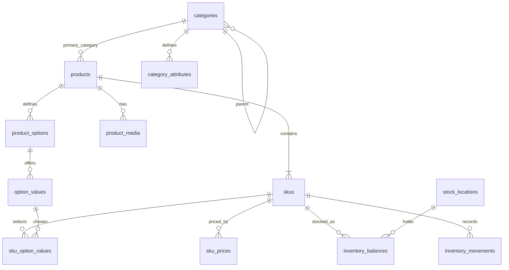

# 商品目录、价格与库存实体设计

日期：2026-09-28

状态：已审阅，进入实施计划
对应需求：`docs/prd-ecommerce-agent.md` 的跨品类选品、SKU 选择、核价与查库存。

## 1. 意图、范围与决定

本项目将自建商品目录与库存，首版按平台自营设计。支付由另一个项目提供；当前仓库的 MVP 只在用户确认后交接宿主结账，不创建支付或宣称支付成功。第一阶段先建立商品、SKU、价格、库存的可信数据基础，使后续 Agent、购物车和结账交接引用同一组稳定 ID 和业务规则。

第一阶段采用**单体部署、领域模块隔离**：目录、价格、库存分别拥有模型、仓储和服务接口，使用同一个 MySQL 实例，但不跨模块直接改写对方的表。等出现独立团队、不同扩容或可用性要求、明确的跨服务一致性方案时，再将模块抽为进程独立的服务。数据库表的分离不等于必须立即拆微服务。

本阶段包括实体、迁移、受控数据导入或管理写入、查询接口、确定性校验和测试。不包括购物车、订单、支付、用户账号、促销、多商家、多币种、多地区销售、库存预留或向量检索。后续购物车阶段必须接入已验证主体或匿名会话；现有 `user_id` 请求字段不构成身份认证。

首版商品范围为按整数件销售的实物商品。称重商品、虚拟商品、组合套装、预售、序列号管理与负库存销售需要单独设计，不能靠放宽当前约束暗中支持。

### 选择依据

| 方案 | 优点 | 代价与结论 |
| --- | --- | --- |
| 单张商品表包含价格和库存 | 改动少 | 无法表达规格级价格、库存和多库位；不采用。当前 `models/schemas.py:Product` 仅适合作为旧接口响应。 |
| **领域模块隔离，单体部署** | 能先落实业务约束，减少网络调用与运维负担；以后可按接口拆分 | **本阶段采用。** |
| 目录、价格、库存立即拆成独立微服务 | 可独立部署 | 在数据与交易规则未稳定前引入分布式一致性、发现、监控和故障处理；暂不采用。 |

## 2. 当前依据和参考边界

- `models/schemas.py` 的 `Product` 以 `price: float`、`stock: int` 表示单层商品；`agents/product_rec_agent.py` 使用 `MOCK_PRODUCTS`；`agents/inventory_agent.py` 从样例对象读取库存，数据库分支尚未实现。
- `infrastructure/mysql_client.py` 提供异步 MySQL 连接，`compose.infra.yml` 提供 MySQL 8.0；`config/settings.py` 的默认 `database_url` 仍是 SQLite，开始持久化前须明确开发和测试配置。项目尚无业务表与迁移工具。
- `docs/prd-ecommerce-agent.md` 已规划 `CatalogProduct/SKU`、`OfferSnapshot/AvailabilitySnapshot`，但它们还不是已实现的数据库模型。
- `ecommerce-agent-references/commerce-agents/shopping-agent/core/shopping_agent/types.py` 区分商品族和可购买变体，可借鉴选择规格的契约；其价格与库存演示字段不是本仓的业务事实。
- `ecommerce-agent-references/e-commerce-agents/docker/postgres/init.sql` 的示例把价格放在 `products`、库存按 `product_id` 记录，适合了解演示范围，不适合直接移植到首版 SKU 级模型。
- 行业模型参考：[Shopify Product/Option/Variant](https://shopify.dev/docs/apps/build/product-merchandising/products-and-collections)、[Shopify InventoryItem/Location](https://shopify.dev/docs/apps/build/orders-fulfillment/inventory-management-apps/manage-quantities-states)、[Medusa 定价概念](https://docs.medusajs.com/resources/commerce-modules/pricing/concepts)。本稿的具体表结构是对本项目需求的设计决定，不声称与这些平台的内部表相同。

## 3. 领域实体和关系

`Product` 是展示、搜索和比较的商品族；`SKU` 是可被购买的确定规格。Product 可以先保存为没有 SKU 的草稿，但上架前至少须有一个 SKU。无选项的商品使用一个默认 SKU，`option_signature` 为固定值 `default`。有选项的商品只允许从已定义的选项值生成 SKU，不自动生成笛卡尔积中的所有组合。SKU 不跨 Product 移动，SKU ID 一旦被购物车或未来订单引用即保持稳定。

商品类目采用一个主类目。可比较属性以 `category_attributes` 定义字段代码、类型和单位，值先保存于 `products.attributes` JSON，并在写入时由目录服务验证；第一阶段不以 JSON 字段做大规模筛选。跨类目比较只显示有可对应定义的字段，缺失值标为未知。商品选项是购买规格，不能用普通展示属性代替。

## 4. MySQL 8.0 表结构

实体主键统一为应用生成的 UUID 字符串 `CHAR(36)`；关联表按表中说明使用复合主键。所有表使用 `utf8mb4`、InnoDB，业务时间以 UTC 保存。可变实体设置 `created_at DATETIME(6)`、`updated_at DATETIME(6)`；不可变流水只保留事件时间。有状态实体采用归档或停用，不物理删除已被引用的记录。数据库迁移通过 Alembic 管理，禁止在应用启动时隐式建表。

| 表 | 关键列与类型 | 核心约束和索引 |
| --- | --- | --- |
| `categories` | `id`, `parent_id NULL`, `code VARCHAR(64)`, `name VARCHAR(128)`, `status`, `sort_order` | `UNIQUE(code)`；`parent_id` 外键；服务层禁止循环引用。 |
| `category_attributes` | `id`, `category_id`, `code`, `name`, `value_type` (`text/number/boolean`), `unit NULL`, `is_comparable`, `is_filterable` | `UNIQUE(category_id, code)`；`is_filterable` 仅表示语义，第一阶段不承诺任意属性索引检索。 |
| `products` | `id`, `category_id`, `product_code VARCHAR(64)`, `name VARCHAR(255)`, `brand NULL`, `description TEXT`, `attributes JSON`, `status` (`draft/active/archived`), `version BIGINT` | `UNIQUE(product_code)`；类目外键；索引 `(category_id, status)`、`(status, updated_at)`。不存价格、库存、卖家 ID。 |
| `product_options` | `id`, `product_id`, `code`, `name`, `sort_order` | `UNIQUE(product_id, code)`、`UNIQUE(product_id, sort_order)`；签名依赖选项 ID 而非展示顺序。 |
| `option_values` | `id`, `option_id`, `code`, `display_value`, `sort_order` | `UNIQUE(option_id, code)`。 |
| `skus` | `id`, `product_id`, `sku_code VARCHAR(64)`, `option_signature CHAR(64)`, `status` (`active/inactive`), `version BIGINT` | `UNIQUE(sku_code)`、`UNIQUE(product_id, option_signature)`、`INDEX(product_id, status)`；签名为按选项 ID 排序后的 `option_id=value_id` 序列的 SHA-256；无选项例外使用 `default`。 |
| `sku_option_values` | `sku_id`, `option_id`, `value_id` | `PRIMARY KEY(sku_id, option_id)`；服务层确保选项和值同属 SKU 的 Product，且每个必选项恰好一个值。 |
| `product_media` | `id`, `product_id`, `sku_id NULL`, `url`, `media_type`, `alt_text NULL`, `sort_order` | `INDEX(product_id, sort_order)`；`sku_id` 非空时须归属同一 Product。URL 由可信目录管理入口保存。 |
| `sku_prices` | `sku_id`, `currency CHAR(3)`, `amount_minor BIGINT`, `version BIGINT`, `effective_at DATETIME(6)` | `PRIMARY KEY(sku_id, currency)`；`amount_minor >= 0`；首版只接受 `CNY`，单位为分。更新时递增版本。 |
| `sku_price_changes` | `id`, `sku_id`, `currency`, `old_amount_minor NULL`, `new_amount_minor`, `price_version`, `reason`, `changed_at` | `UNIQUE(sku_id, currency, price_version)`；价格更新与变更记录同事务。 |
| `stock_locations` | `id`, `code`, `name`, `status` | `UNIQUE(code)`；首版至少一个默认库位。 |
| `inventory_balances` | `sku_id`, `location_id`, `on_hand BIGINT`, `reserved BIGINT DEFAULT 0`, `version BIGINT` | `PRIMARY KEY(sku_id, location_id)`；`0 <= reserved <= on_hand`；可售量为 `on_hand - reserved`。第一阶段不开放预留写入，`reserved` 保持 0。 |
| `inventory_movements` | `id`, `sku_id`, `location_id`, `delta BIGINT`, `reason`, `idempotency_key`, `balance_version`, `occurred_at` | `UNIQUE(idempotency_key)`、`UNIQUE(sku_id, location_id, balance_version)`；库存调整与流水同事务。 |

MySQL 的外键与唯一约束承担基础完整性；跨行、跨表条件由领域服务在事务内校验，并用测试覆盖。`sku_option_values` 中选项和值的同商品归属、Product 上架前至少一个 SKU、归档条件都不能只靠单列检查约束保证。

## 5. 业务规则与写入事务

1. **上架**：Product 为 `active`，至少一个 `active` SKU，每个可售 SKU 具有完整选项组合和当前 CNY 价格，才可在商品发现中展示为可购买候选。没有有效价格时可以保留草稿，但不能产生可加购报价。上架状态与实时库存分开；缺货不自动下架。
2. **SKU 唯一性**：目录服务在同一事务中规范化选项组合、生成 `option_signature` 并写入 SKU 与关联值。签名前使用固定编码和分隔规则，防止不同组合生成同一原文；数据库唯一约束拒绝重复签名。`sku_code` 作为平台自营全局唯一业务编码。SKU 规格发生实质变化时创建新 SKU，不原地把旧 SKU 改成另一种实物。
3. **价格**：服务接收整数分或精确 Decimal，拒绝浮点数；数据库只存 `amount_minor`。读接口返回金额和币种，不让 Agent 自行推导促销或最终应付金额。价格更新以版本比较防止覆盖，并同事务记录 `sku_price_changes`。
4. **库存**：仅库存模块可写 `inventory_balances`。调整请求带 `idempotency_key`；在同一数据库事务内锁定目标余额行，验证调整后 `on_hand >= reserved >= 0`，递增版本，写入 `inventory_movements`，提交后返回新余额。重复请求返回原结果或明确重复状态，不再次加减。
5. **可售查询**：返回 SKU、库位汇总可售量、状态、版本和查询时间。SKU 不存在、库位无记录、服务故障分别是不同结果；未知不能当作有货。购物车阶段在确认写入与结账交接前重新读取价格与库存。第一阶段的查询不预留库存，也不保证未来一定可买。
6. **归档**：已引用的 Product/SKU 不物理删除。归档 Product 时停止发现；既有购物车或未来订单应保留商品与价格快照，并在实际交易动作前重新校验。

## 6. 模块接口与依赖方向

建议在仓库中设立 `catalog/`、`pricing/`、`inventory/`，各自包含 ORM 模型、仓储、领域服务和对外 DTO；`models/schemas.py` 中旧推荐响应模型先保持兼容，由显式适配器从新领域对象构造。`api/` 只做鉴权/参数/响应适配；`agents/` 与 `orchestrator/` 依赖查询服务，不持有数据库会话或直接更新库存。后续购物车依赖 `sku_id`、价格版本和库存查询契约，支付项目不直接读写本仓业务表。

| 接口 | 输入 | 输出或错误 |
| --- | --- | --- |
| `CatalogService.get_product(product_id)` | Product ID | 商品及有效 SKU、选项、媒体；未找到/已归档显式区分。 |
| `CatalogService.search(category_id, text, limit, cursor)` | 目录筛选 | 商品摘要与稳定游标；首版不承诺语义搜索。 |
| `CatalogService.get_sku(sku_id)` | SKU ID | 所属 Product 与确定的选项组合；停用状态显式返回。 |
| `PricingService.get_prices(sku_ids)` | SKU ID 列表 | 每 SKU 的价格、币种、版本、读取时间；无价不回填旧价。 |
| `PricingService.set_price(sku_id, amount_minor, expected_version, reason)` | 受控管理命令 | 新版本；版本冲突或无效金额拒绝。 |
| `InventoryService.get_availability(sku_ids)` | SKU ID 列表 | 每 SKU 的 `available/out_of_stock/unknown`、数量、版本、读取时间。 |
| `InventoryService.adjust(sku_id, location_id, delta, idempotency_key, reason)` | 受控管理命令 | 新余额；重复请求返回原结果，负库存或不存在的余额行明确拒绝；同行写入由数据库锁串行化。 |

这些是 Python 内部接口，不表示第一阶段必须全部暴露为公网 HTTP API。数据导入和管理写入先使用受控命令或管理接口，面向消费者优先提供只读商品和可售查询。未来拆服务时以这些接口为迁移边界，数据库禁止被新服务跨域共享写入。

## 7. 实施边界与验证

第一阶段实施顺序：① MySQL 连接配置与 Alembic 基线；② 目录表和导入/查询；③ SKU 组合与属性校验；④ 价格表、精确金额和版本更新；⑤ 库存余额/流水与原子调整；⑥ 旧推荐模型适配和确定性查询测试。真实 Agent 购物流程、购物车和支付衔接在下一阶段单独设计与实施。

验收至少覆盖：无规格商品有默认 SKU；多规格商品只返回实际存在的组合；重复 `sku_code` 或重复组合失败；无价/停用/归档商品不标为可加购；价格更新保留版本记录；库存调整幂等且并发下不能出现负库存；未知库存不标为有货；按 SKU 读取而非按 Product 汇总后误判。测试使用隔离 MySQL 或等价的数据库约束测试，不能仅用内存桩证明事务与唯一约束。现有 `models/schemas.py:Product.price/stock` 和样例商品不作为验收数据源。

## 8. 后续阶段与已知决策

- **购物车与身份**：建立可信主体或匿名会话、Cart/CartLine、确认与幂等写入；购物车行引用 SKU 并保存展示快照，价格与库存仍须实时核验。是否自建用户账号服务在该阶段决定；画像 Agent 不代替认证。
- **订单与支付项目集成**：先确定订单归属、结账请求、金额锁定、库存预留/释放、支付结果回调和对账责任，再定义跨项目接口。第一阶段不为尚未确定的支付协议建表。
- **多商家/多币种/多地区**：首版不建卖家报价体系；一旦需要同一商品由多个卖家销售，需引入 Seller/Listing/Offer，不能简单给当前 Product 加一个 `seller_id` 后复用自营价格模型。
- **搜索与推荐**：MySQL 是业务主数据；未来 Milvus/搜索索引是可重建投影，按商品版本同步，不是价格或库存事实来源。

设计假设已由项目负责人确认：本项目维护目录与库存、首版平台自营、先按领域分模块并单体部署。支付项目的具体接口和用户账号归属未在第一阶段确定，不阻塞本阶段实体落地。
