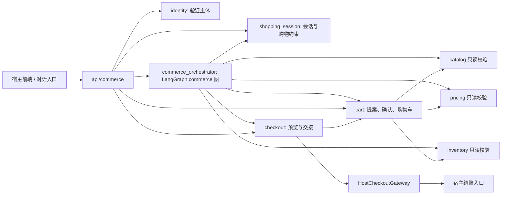

# 电商 Agent MVP 架构与交易交接设计

日期：2026-09-29

状态：设计已审阅通过（含 2026-09-30 编排修订）

编排选型修订：2026-09-30，按评审结论采用独立的 LangGraph commerce 流程。

对应需求：`docs/prd-ecommerce-agent.md` 的 P0/F01–F10，覆盖“表达需求 → 发现与比较 → 选 SKU → 确认加购 → 核价 → 结账交接”旅程。身份、购物车和交接是本稿重点。

## 1. 目标、决定与范围

本设计让已登录用户从自然语言购物需求走到宿主结账交接。MVP **只支持已登录用户**；同一用户跨会话共享一辆活动购物车。商品目录、价格和库存由本项目维护，继续使用同一 MySQL 部署和分领域模块，不拆新的购物车微服务。商品事实和交易门禁由确定性服务负责，LLM 只解析需求、排序可信候选及撰写基于事实的说明。用户确认之前不写车；交接之前重新读取商品、价格和库存。交接只说明购物准备已移交宿主，不创建订单、不预留库存、不扣款，也不声称支付成功。

本阶段覆盖自建身份模块、购物会话、需求解析、真实目录发现、报价与库存核验、同类商品比较、可信排序、SKU 选择、购物车提案与确认、结账交接和事件反馈。订单、支付、物流、售后、优惠券、运费、税费、匿名购物车与登录合并不在本阶段。PRD 的 F11 个性化实验与 F12/F13 查单售后留到后续版本。

身份来源改为**本项目自建 `identity/` 模块**，账号、登录、令牌与撤销的设计见 [身份模块演示版设计](2026-09-29-identity-module-design.md)。演示注册以邮箱作登录名并校验本地密码，不发邮件、不验证邮箱所有权；令牌签发、逐请求验证与主体归属仍使用真实代码和持久化数据。本仓以不可变用户 UUID 建立主体，购物入口只通过 `IdentityProvider.verify(token) -> Principal` 获取身份。固定 `Principal` 仅用于单元测试；演示账号不能作为面向真实用户的生产身份。请求中的 `user_id` 不能作为临时认证方案。

当前依据：`catalog/models.py` 的 Product/SKU，`pricing/models.py` 的 `amount_minor` 和版本，`inventory/models.py` 的 SKU 库位余额，以及 `api/commerce_read.py` 的只读报价。`identity/` 与 `api/identity.py:require_principal` 已实现并通过独立验收，但购物交易路由尚未接入该依赖。现有 `models/schemas.py:RecommendationRequest.user_id` 仅是旧接口的请求字段。`orchestrator/supervisor.py` 与 `orchestrator/graph.py` 是旧推荐编排，不能直接当作含会话状态与交易确认的 MVP 流程；旧图在库存过滤后结果为空时回填未验证候选，新流程禁止这种行为。`agents/product_rec_agent.py` 的样例商品不能作为真实在售结果。`docs/superpowers/specs/2026-09-28-catalog-pricing-inventory-design.md` 已将购物车和支付留到下一阶段。

## 2. 方案比较

| 方案 | 适用性与代价 | 决定 |
| --- | --- | --- |
| **本仓 `identity/` + MySQL 购物车 + 宿主交接接口** | 复用现有应用和数据库，主体与购物车归属可在本仓验证；演示注册无需邮件，但不证明邮箱归属 | **采用**。身份模块按独立设计交付；面向真实用户上线前须补齐正式账号来源，宿主结账仍需接入。 |
| 本仓同时自建账号、购物车、订单、支付 | 单仓可控，但订单履约和支付会扩大本期范围 | 本期只自建账号和购物车，不自建订单与支付。 |
| 直接把购物车送入 `vivix-billing.CreateStripeCheckout` | Billing 当前只接收其目录中的单个 Stripe `price_*`，实际创建一条数量为 1 的行，并按积分/订阅履约 | 本期不采用。未来如复用 Billing，新增实物多行结账契约，不改变本仓 `sku_id` 的含义。 |

参考边界：`ecommerce-agent-references/commerce-agents/shopping-agent/core/shopping_agent/backend.py` 把购物车操作与 `checkout_handoff` 留给宿主；`gates.py` 的“已见商品及变体”门禁可借鉴，但其进程内会话锁不能替代本仓 MySQL 并发控制。`ecommerce-agent-references/e-commerce-agents/agents/python/shared/tools/cart_tools.py` 展示登录用户读写车的工具形态，使用的是示例库、按 Product 而非本仓 SKU 购物车。兄弟仓库 `../vivix-billing/proto/svrproto/paymentsvrproto/param.proto:375` 和 `../vivix-billing/app/payment/internal/provider/stripe/gateway.go:580` 是上述 Billing 边界的源码依据。

### 2.1 Agent 框架选型与后续演进

选型要求是：MVP 能明确分支并复用现有异步 FastAPI/LLM 接入；模型只能提取约束、在可信候选内排序与解释；跨轮购物状态、提案和交易结果由 MySQL 记录。后续 V1 个性化推荐需要独立演进召回、排序与实验，V2 查询型客服需要可信订单/物流工具，V3 退换退款才可能需要长时间暂停、人工审批与恢复。比较以官方文档截至 2026-09-30 的能力和本仓已安装的 LangGraph/LangChain 为依据：

| 候选 | 符合点 | 本项目取舍 |
| --- | --- | --- |
| [LangGraph `StateGraph`](https://docs.langchain.com/oss/python/langgraph/workflows-agents) | 显式节点、条件分支、异步调用；现有 `orchestrator/graph.py` 和依赖可复用经验 | **采用**为新增 commerce 图的编排层；节点、重试与图状态需自行约束，不以图替代业务事务。 |
| [LangChain `create_agent`](https://docs.langchain.com/oss/python/langchain/agents) | 工具调用循环和结构化输出适合开放式子任务 | 模型自行选择工具的范围超过当前交易路径所需；保留 LangChain 模型客户端，MVP 不用通用 Agent 循环统领交易。 |
| [CrewAI Flows/Crews](https://docs.crewai.com/en/concepts/flows) | Flows 有分支、持久化和人工反馈，Crews 适合角色协作 | 可行备选，但要新增框架并决定其流程状态如何与现有 MySQL 会话/动作对应；当前没有必须采用角色自治协作的需求。 |
| [AgentScope 2.0](https://docs.agentscope.io/stable/en/index) | 提供 ReAct、权限和完整 Agent 服务能力 | 适合将来独立运营复杂 Agent 服务；本期只需单仓购物编排，引入新运行时的集成与维护成本较高。 |
| [AutoGen GraphFlow](https://microsoft.github.io/autogen/stable/user-guide/agentchat-user-guide/graph-flow.html) / [Microsoft Agent Framework](https://learn.microsoft.com/en-us/agent-framework/overview/) | 均覆盖多 Agent 工作流；后者是 AutoGen 的直接后继 | AutoGen GraphFlow 仍标为实验性；转向另一套框架需重接本仓服务与状态，本期无收益证据。 |

**决定**：MVP 的对话购物入口新增独立 `commerce_orchestrator/graph.py`，不把交易能力叠加到旧 `orchestrator/graph.py` 的样例推荐图。LangGraph 只调度明确授权的节点；高频首页推荐的召回、排序、库存过滤和 A/B 实验仍由普通异步业务服务完成，是否经图入口取决于交互是否需要多步路由。未来客服先复用可信只读查询接口；需要跨请求人工审批时可单独设计 support 图及持久 checkpoint。框架不能代替商品事实、权限、幂等和交易状态。若出现独立部署的 Agent 团队、复杂自治协作或实测的维护/时延问题，再以同一领域 DTO 对 CrewAI、AgentScope 或 Microsoft Agent Framework 做原型比较。

## 3. 领域边界与依赖

- `identity/` 负责本仓演示邮箱密码账号、登录会话、访问令牌、刷新与撤销，并向购物域提供 `Principal(issuer, subject, principal_key)`；详见[独立设计](2026-09-29-identity-module-design.md)。每次请求必须验证签名、签发方、受众、有效期及本仓账号/会话撤销状态；任何主体字段均不从购物请求体获得。演示账号不能用于真实用户生产交易。未来需传给 Billing 的 `user_id` 由受信身份映射取得。
- `shopping_session/` 持有 `session_id`、主体、过期时间、结构化购物约束、已展示 Product/SKU 和轮次幂等记录；会话不拥有购物车。令牌刷新后，只要验证得到同一主体即可继续访问。会话过期不删除购物车。
- `commerce_orchestrator/` 以独立 LangGraph `StateGraph` 处理 P0 意图路由、条件提取、目录发现、报价库存核验、比较、排序及动作提案；节点只调用受控领域接口，不直接读写 ORM。旧推荐 API 可继续服务既有调用方，新购物流程不允许从样例商品回填。
- `cart/` 独占 `carts`、`cart_lines`、`pending_actions` 写入，协调目录、价格和库存的事务内校验。Agent 仅生成动作提案，不能直接提交写入。
- `checkout/` 负责交接预览、确认、持久记录和 `HostCheckoutGateway`。宿主负责后续订单与支付，必须独立核价、校验库存和授权；本仓交接快照不能充当锁价或库存承诺。
- `catalog/`、`pricing/`、`inventory/` 仍拥有各自数据和规则。为写车事务增加显式的同事务校验接口；`cart/` 不直接更新这三个模块的表。

模块间使用 Python Protocol/领域 DTO；`api/` 做鉴权、输入校验和错误映射。继续使用现有 SQLAlchemy 异步会话、Alembic 迁移、UTC `DATETIME(6)` 与对外 `UtcDateTime`。旧推荐 API 保持原契约；新增交易端点不复用其可由调用方填写的 `user_id`。

## 4. 数据模型

所有新增主键使用现有应用生成的 UUID `CHAR(36)`；金额只用整数分，首版币种 `CNY`。以下为设计列，索引和约束随迁移一起落地，不通过应用启动建表。

| 表 | 关键字段 | 约束及用途 |
| --- | --- | --- |
| `commerce_sessions` | `id`, `principal_key`, `status`, `expires_at`, `state_json`, `version`, `active_turn_id`, `turn_lease_token`, `turn_lease_expires_at`, `created_at`, `updated_at` | `principal_key = issuer + subject` 的稳定编码；按 `principal_key, expires_at` 索引。`state_json` 只保存购物条件和对话状态，不存认证令牌。一次只允许一个有效轮次租约；建议会话有效期 24 小时，可配置。 |
| `session_seen_products` | `session_id`, `product_id`, `first_seen_at` | 复合主键；比较只接收本会话目录工具确实展示过的商品族。 |
| `session_seen_skus` | `session_id`, `sku_id`, `first_seen_at` | 复合主键；只允许本会话已由目录工具返回的 SKU 生成新增加购提案。既有购物车行可做改量/移除。 |
| `commerce_turns` | `session_id`, `turn_id`, `request_hash`, `status`, `response_json`, `created_at` | `UNIQUE(session_id, turn_id)`；同轮同参回原响应，同轮异参冲突。`processing/completed` 配合会话租约恢复；保存经校验后的响应，不保存明文访问令牌。 |
| `carts` | `id`, `principal_key`, `version`, `created_at`, `updated_at` | `UNIQUE(principal_key)`；一名登录用户一辆活动车。购物车版本从 1 起，任何有效行变更递增。 |
| `cart_lines` | `id`, `cart_id`, `sku_id`, `quantity`, `product_name_snapshot`, `sku_options_snapshot`, `image_url_snapshot`, `last_seen_unit_amount_minor`, `last_seen_price_version`, `created_at`, `updated_at` | `UNIQUE(cart_id, sku_id)`、外键 `sku_id`；`quantity > 0`。快照供历史展示，不能作现行价或可售依据。`last_seen_*` 可空，表示此前校验失败或无价。 |
| `pending_actions` | `id`, `session_id`, `source_turn_id`, `principal_key`, `cart_id`, `kind`, `payload_json`, `expected_cart_version`, `quote_snapshot_json`, `status`, `expires_at`, `confirmation_key`, `result_json`, `created_at`, `updated_at` | `kind=add/set_quantity/remove/checkout_handoff`；`status=pending/declined/consumed/invalidated/expired`。`UNIQUE(session_id, source_turn_id)` 对聊天轮次提案去重，直接预览可为空；`UNIQUE(principal_key, confirmation_key)` 对确认去重。相同轮次恢复时只能复用原提案，异参冲突；建议提案 10 分钟过期。 |
| `checkout_handoffs` | `id`, `principal_key`, `cart_id`, `cart_version`, `action_id`, `snapshot_json`, `snapshot_hash`, `status`, `destination_kind`, `destination_ref`, `expires_at`, `created_at`, `updated_at` | `UNIQUE(action_id)`；`status=preparing/ready/failed/expired`。记录交接时的不可变商品摘要和宿主引用，不存支付结果。URL 若会过期，重复调用只可返回仍有效的记录；失效后需重新预览和确认。 |
| `commerce_events` | `event_id`, `session_id`, `principal_key`, `request_id`, `kind`, `occurred_at`, `payload_json` | `event_id` 唯一；只记录曝光、比较、确认、车变更、交接等 P0 事件。支付转化不是本阶段事件。事件失败不影响购物业务提交。 |

`quote_snapshot_json` 包含每行 `product_id`、`sku_id`、规格、数量、单价分、币种、价格版本、可售量、检查时间；不包含促销、运费或税费。`checkout_handoffs.snapshot_json` 还包含小计和车版本。`principal_key` 是内部所有权键，不直接暴露给前端；如身份服务 `issuer` 或 `subject` 迁移，需明确映射方案，不能直接修改已有归属。

## 5. 从需求到可信 SKU 的编排

### 5.1 会话状态和意图（F01/F02）

新流程采用明确的 `ShoppingIntent` DTO，至少包含 `category_id`、`query_text`、`budget_max_minor`、`currency`、`purpose`、`hard_conditions[]`、`soft_preferences[]`，每项记录 `source=explicit/session/inferred`。只把用户明说或确认的条件作为硬过滤；模型推断只能影响排序。新一轮明确修改覆盖旧约束，例如“改为 1500 元”覆盖此前的 2000 元上限。类目和属性代码必须映射到本仓 `categories`、`category_attributes`，不能由模型自造。冲突或缺少可搜索信息时状态为 `clarify`，一次只问一个可回答的问题。结构化状态写入 `commerce_sessions.state_json` 并递增版本，不能只放在提示词中。

意图至少分 `shop`、`compare`、`cart_read`、`cart_mutation`、`checkout`、`order_tracking`、`after_sales`、`unknown`。MVP 的查单与售后只返回 `unsupported` 和可用的宿主入口；不能查询或编造订单。`turn_id` 的重试先查持久结果；处理中轮次由数据库租约保护，同会话另一 `turn_id` 在有效租约期间返回可重试状态。过期恢复取得新令牌；旧执行者完成轮次或生成提案时必须验证当前租约，避免迟到结果覆盖状态。模型异常时保留用户显式条件，要求用户编辑条件或继续使用确定性目录查询。

### 5.2 发现、报价与排序（F03/F04/F05）

发现以 `CatalogService.search` 与 `get_product/get_sku` 为事实源，按商品族呈现，不使用 `MOCK_PRODUCTS`、推荐模型内的 `price: float/stock: int` 作为交易事实。MVP 支持目录内多个类目；无类目限制时可跨类目搜索。每个候选 SKU 批量读取 `PricingService.get_prices` 与 `InventoryService.get_availability`，根据 Product/SKU 状态、CNY 价格、可售量、预算和经验证的类目属性执行代码级硬过滤。库存 `unknown`、无价、依赖异常均不能列为可加购；价格/库存异常要显示来源故障，不得用缓存样例补足结果。对外引用价格版本、可售检查时间及状态。当前 `api/commerce_read.py` 的单 SKU 报价可复用规则，但需要内部批量报价接口，避免逐个 SKU 请求形成 N+1。

`CatalogService.search` 目前仅支持类目和名称/编码文本查询；任意属性的数据库筛选尚未实现。因此属性硬条件要由新的目录查询能力或受控分页扫描做确定性过滤；达到扫描上限时返回 `incomplete=true`，不能把有限候选说成完整匹配结果。预算按 SKU 当前价格过滤，不按 Product 的展示最低价推断所有规格可买。若没有合格候选，输出明确的空结果和可放宽的条件，不补入违背硬条件的商品。

排序在硬过滤后的固定候选集合上进行：先提供可解释的确定性排序，再允许 LLM 在同一 ID 集内重排和生成理由。校验模型输出 ID 集、去重、数量上限及理由所引用的目录属性；无效或超时则回退确定性顺序与中性文案。模型不执行价格计算，不作优惠、销量、评价、送达承诺。展示后的 Product/SKU 才写入 `session_seen_*`，用于后续比较和加购溯源。短名单长度暂按 PRD 建议最多 3 款，正式值可配置。

### 5.3 比较和规格选择（F06）

比较只接收同会话已展示的 2–3 个同类目 Product ID。维度来自该类目的 `category_attributes.is_comparable`；数字按同一单位展示，缺失值写“未提供”。跨类目输入返回可分组提示，不做无依据的强行比较。用户选择颜色、尺寸等规格时，系统只返回 `CatalogService.get_product` 中确实存在的 SKU 组合；有选项的商品族不能直接加购。选择 SKU 后重新核价查库存，并记录该 SKU 已展示，再允许生成购物车提案。

### 5.4 Agent 与确定性服务分工

| 组件 | 职责与输入输出 | 门禁 |
| --- | --- | --- |
| 意图/约束解析 Agent（新增） | 由本轮消息和已存 `ShoppingIntent` 生成结构化更新提案 | schema 校验、类目/属性映射、用户显式条件优先；不推断身份 |
| 商品发现与推荐组件（改造） | 查询真实目录、获取批量报价和库存，输出候选 ID 与排序 | 硬过滤在代码完成；LLM 只能重排已校验候选，不可新造商品 |
| 比较与说明组件（新增） | 从目录属性和 SKU 组合生成比较矩阵及基于事实的理由 | 不同类目、缺失属性和单位冲突由确定性逻辑处理 |
| 购物车执行组件（新增，确定性服务） | 生成动作摘要，确认后在事务中写车 | 已见 SKU、主体、版本、幂等、价格和库存校验全部由服务执行 |
| 独立 Commerce StateGraph（新增） | 连接意图、发现、比较、读车、提案与交接预览分支，返回统一 `status` | 图节点不直接改 ORM；不能触发确认命令或把无效依赖结果回填为可买候选 |

响应状态采用 `clarify/shortlist/compare/confirm_action/cart_updated/handoff/unsupported/unavailable`；`handoff` 只来自已完成的宿主交接，不代表订单或付款。`POST /turns` 对所有开放意图返回统一 envelope：`request_id`、`session_id`、`turn_id`、`intent`、`status`、`constraints`、`items[]`、`question`、`proposed_action`、`errors[]`。路由到未开放意图时保持同一形状。已有两条推荐入口可作为兼容接口保留，但 MVP 的购物交易入口须共用一条可信业务流水线。Agent 可调用只读查询和 `propose_action`，不暴露直接写车或创建交接的工具；所有写入通过下面的确认命令。

#### 5.4.1 Commerce 图的执行契约

`CommerceOrchestrator.turn` 先验证主体与会话并取得 `TurnClaim(session_id, turn_id, lease_token, session_version)`；已完成的同参轮次直接回放。携带 `respond_to_action_id` 的聊天确认先由确定性代码核对动作、精确短语和幂等键，再调用与按钮相同的确认命令，**不进入图或模型**。其余轮次使用异步 `graph.ainvoke`：`parse_intent → validate_route`，然后按意图走 `discover → quote_filter → rank_explain`、`compare`、`read_cart`、`propose_cart_action` 或 `preview_checkout`，最终汇入 `finalize`；条件不足走 `clarify`，未开放的查单/售后走 `unsupported`，可信依赖故障走 `unavailable`。规格选择仍经目录校验与重新报价。图输入和临时状态只含本轮消息、已验证的购物条件、候选事实、轮次标识和响应草稿；不含 Bearer、刷新令牌或密码。只有验证过的 Product/SKU ID 能进入输出。

`propose_cart_action` 和 `preview_checkout` 节点只能通过 `CartService.propose_action` / `CheckoutService.preview` 创建**待确认提案**，传入当前 `TurnClaim`。服务在短事务中校验仍持有有效租约及会话版本，并以 `(session_id, source_turn_id)` 唯一键保证同轮重试复用相同提案；异参返回冲突。图返回后，编排器以当前租约和会话版本完成轮次、保存结构化状态及最终响应。租约失效的旧执行者不能提交响应或提案；提案已持久化但响应尚未保存时，同轮恢复读取原提案，不再生成第二个动作。若原提案已失效，返回需要新轮次重新提案的状态，不把旧快照恢复成可确认动作。模型调用及外部网络调用均不持有上述数据库锁。

MVP 每次从 MySQL 的 `commerce_sessions.state_json` 和轮次/动作记录恢复输入，图的 State 仅在单次 `ainvoke` 内有效；**不启用 LangGraph checkpointer 或 `interrupt()`**。因此图 checkpoint 不是购物业务的第二份事实来源。将来客服若需要跨请求暂停审批，可单独设计 support 图和持久 checkpoint；[官方中断语义](https://docs.langchain.com/oss/python/langgraph/interrupts)要求 durable checkpointer 与稳定 `thread_id`，恢复时节点从头重执行，任何外部写工具仍须由业务服务保证幂等。V1 推荐优化按需复用图外的召回、排序、硬过滤和实验服务，不把高频推荐接口强制迁入 commerce 图。

### 5.5 页面与反馈（F10）

宿主页面至少能渲染输入、候选卡、比较矩阵、SKU 选项、待确认动作、购物车行状态和交接卡，并明确区分 `unavailable`、空结果、缺货、价格变化及写入失败。只有卡片实际可见时才上报曝光。`POST /api/v1/commerce/events` 接收 `event_id`、`session_id`、`request_id`、`kind` 和有限结构化属性，按 `event_id` 去重；事件采集失败不改变购物车或交接结果。埋点口径见 PRD 第 7 节，正式目标须建立基线后确认。

## 6. 身份、会话与授权

### 6.1 验证“请求者是谁”

交易相关请求使用 `Authorization: Bearer <access_token>`；前端通过本项目的登录或刷新接口取得短期访问令牌。FastAPI 依赖 `require_principal` 在进入业务服务前调用 `IdentityProvider.verify(token)`。自建 `identity/` 按[独立设计](2026-09-29-identity-module-design.md)用服务端配置的公钥与固定算法验证 JWT 的 `kid`、签名、`iss`、`aud`、`iat`、`nbf`、`exp`、非空 `sub` 和 `sid`，并查询本仓账号与登录会话状态以落实即时撤销。不能使用令牌自带的任意 URL 取密钥；测试替身不能在生产环境启用。

验证成功后形成 `Principal(issuer, subject, principal_key)`；`subject` 是不可变的 `identity_users.id`，`principal_key` 对 `(issuer, subject)` 做无歧义稳定编码，避免未来接入其他身份提供方时相同 `sub` 串户。`user_id` 若未来要传给 Billing，必须由受信身份映射取得，不能直接取 HTTP 请求体、查询参数或普通自定义头。每次请求都重新验证当前凭证；24 小时购物会话不延长访问令牌有效期，过期后用户须刷新或重新登录。凭证缺失、签名/声明无效、过期或账号/会话已撤销返回 401；验证依赖故障时拒绝受保护操作并返回 503，不把故障当作匿名登录。公开商品只读接口可继续匿名读取。

### 6.2 验证“能否访问这份资源”

`POST /sessions` 由服务端生成会话 ID 并保存 `principal_key`；同一用户跨会话共享按 `principal_key` 唯一的购物车。访问 `/sessions/{id}` 下的轮次、比较、购物车、动作及交接时，先按 `session_id + principal_key` 查询活动会话，确认未过期，再按同一主体查询车、动作和交接记录。外部传入的 `cart_id`、`action_id`、`handoff_id` 只用于定位，不能代替所有权检查。其他用户的资源统一返回 404，避免泄露其是否存在；本人会话已过期返回 `session_expired`，要求创建新会话，原购物车仍保留。服务层也校验归属，不能只依靠路由依赖。

会话中持久记录已展示 Product/SKU，来源只能是目录工具实际返回且已展示的结果；自然语言中的商品名或 ID 不会自动变成“已见”。`turn_id` 用于同会话轮次幂等，数据库唯一约束保证同轮重试一致。确认动作还须校验 `pending_actions.principal_key`、`session_id`、`cart_id` 与当前主体及车一致，再检查状态、版本和幂等键。Agent 只接收服务端传入的主体标识与允许的数据范围，不能从聊天文本推断用户身份或扩大查询权限。

### 6.3 宿主交接与上线前提

宿主读取交接快照应使用独立的服务身份；交接 URL 或 `handoff_id` 仅为定位符，还要验证请求中的终端用户主体与 `checkout_handoffs.principal_key` 一致。宿主与本服务必须约定内部用户 UUID 的映射、账号禁用的生效要求，以及服务凭证轮换方式。本仓身份模块的稳定 `issuer`、`audience`、签名密钥和撤销检查须落实；内部演示允许未验证邮箱账号，面向真实用户上线前必须另行解决账号归属验证与恢复。开发测试可注入固定 `Principal`，但替身只能在测试配置下启用，并须覆盖跨用户读车、确认和交接的拒绝场景。

## 7. 购物车操作与确认

### 7.1 生成提案

用户说“加入购物车”或“改为两件”时，对话层只调用 `CartService.propose_action(...)`。新增 SKU 必须是本会话已展示且仍归属有效 Product 的具体 SKU；改量/移除必须定位到本人车的行。服务读取现行报价与库存，生成可见摘要和 `action_id`，包括 Product 名称、规格、数量、单价、币种、当前小计、报价时间及潜在变化。返回 `status=confirm_action` 和结构化 `proposed_action`；前端必须展示该摘要及确认/取消控件。无价、停用、库存未知或不足时不给可确认的加购提案。数量必须是正整数；移除用独立操作，不以负数或 0 偷换语义。限购政策尚无权威来源，MVP 不声称已有跨订单限购；建议先配置每行数量上限，正式值待产品确认。同一会话产生新提案时将旧的未决提案置为 `invalidated`，避免“确认”指向多个动作。

### 7.2 确认与事务

**执行入口是确定性确认命令，不是 Agent 自主调用写工具。** 用户点操作卡的“确认/取消”时，前端调用 `POST /sessions/{id}/actions/{action_id}/confirm`，提交 `approved` 与稳定的 `idempotency_key`。用户在聊天里输入确认时，`POST /turns` 须附当前可见的 `respond_to_action_id` 和稳定的 `idempotency_key`；MVP 只把去除首尾空白后的“确认”“确认加购”“确认修改”“确认移除”“确认结账”及“取消”识别为明确决定，且动词必须匹配动作类型。编排层验证该动作仍是本会话唯一待确认动作，再调用同一个 `CartService.confirm` 或 `CheckoutService.confirm_handoff` 命令。文本包含改数量、换 SKU 等新要求，或动作目标不明确时，只返回澄清/新提案，不写车。Agent 的意图判断不能代替上述代码门禁。两种入口共用主体校验、动作状态、版本、幂等与审计规则。

`approved=false` 将提案置为 `declined`，不写车。确认成功返回整个购物车和新版本。加购增加已有行数量；改量采用目标数量；移除删除指定行。写车事务按固定顺序锁定本人车、待确认动作、对应 Product/SKU、现行价格、该 SKU 的库存余额行；通过各领域接口检查活动状态、价格、可售量与车中最终数量，最后写行、递增车版本、保存确认结果并提交。数据库唯一约束与行锁处理并发，不能用进程内锁代替。

确认时必须重查事实。价格金额/版本、规格、可售状态或可售数量相对用户所见摘要变化时，把旧动作置为 `invalidated`，返回 `reconfirmation_required` 和新摘要，不写车；用户只能确认基于新摘要生成的新动作。若仅库存余额内部版本变化，而可售数量和状态不变，可继续；库存不足则拒绝。依赖故障不写车。购物车写入**不预留库存**；提交后库存仍可能变化，读车和交接会再次核验。

同一动作同一确认键重试回放原 `result_json`，不再次加量；同键不同动作/参数返回 409。确认键应由客户端在首次提交前生成并在重试中保持稳定。`expected_cart_version` 不符返回最新车版本和冲突，不自动合并多端修改。事务提交之后才将“已加购”返回给用户。

### 7.3 查看购物车

`GET cart` 从持久行读取 SKU 和展示快照，再批量读取当前目录状态、价格与库存，返回每行 `available/out_of_stock/unknown/inactive/price_missing` 等状态。`last_seen_unit_amount_minor` 只用于提示涨价或降价；有效小计由当前价格计算。任一行无法取得可信价格时，`current_subtotal` 为空且 `checkout_eligible=false`，不能把旧快照相加充当待付款金额。缺货行保留在车中，便于用户移除或稍后重试。运费、税费和优惠不在车小计中。

## 8. 结账预览与交接

1. 用户要求结账时，`CheckoutService.preview(cart_id, principal)` 批量重新检查所有行的 Product/SKU 状态、价格、库存和数量；空车或任一行不可买则返回逐行原因，不生成可确认交接动作。通过后生成带 `cart_version` 和逐行报价快照的 `checkout_handoff` 提案。页面明确显示“商品小计”，并说明运费、税费、优惠与最终应付以宿主结账为准。
2. 用户确认交接时，按钮调用 `POST /checkout-handoff`；聊天确认沿用第 7.2 节的 `respond_to_action_id` 规则，由编排层调用同一个 `CheckoutService.confirm_handoff`，Agent 不直接调用宿主网关。服务检查主体、动作状态/有效期、车版本和再次取得的事实。金额、币种、规格、可售状态或可售数量与预览不同，旧动作置为 `invalidated`，返回新的预览并要求重新确认。确认成功先在本地事务持久化不可变 `checkout_handoffs` 记录，状态为 `preparing`，同时将动作置为 `consumed`；再以稳定的 `action_id`/`handoff_id` 调用 `HostCheckoutGateway.create_handoff`。不在持有 MySQL 行锁期间调用宿主网络接口。相同确认键重试时，读取对应交接记录继续或返回结果，不再重新消费动作。
3. 宿主接口接收 `handoff_id`、可信主体、车版本、商品行与金额快照、过期时间及幂等键，返回受控的宿主路由标识或 URL。URL 只能来自配置的宿主与允许的 scheme/host/path，不能由 LLM、用户输入或商品文本生成。宿主必须按 `handoff_id` 幂等，并在实际建单前独立核价、校验库存、确认地址与最终金额；本仓的库存读取不构成预留。
4. 宿主返回后，本仓把交接记录置 `ready` 并返回 `status=handoff`、`handoff_id`、目的地和失效时间。交接失败或超时返回可重试状态，不宣称交接成功；重试使用相同幂等键，先回查既有交接记录，再与宿主协调恢复，避免生成多个有效目的地。宿主结账开始后若车再变，宿主应使用不可变交接快照并重新确认差异；不得静默读取新车代替用户确认过的车。
5. 若未配置真实宿主结账接口，生产端点返回 `checkout_unavailable`（503），不生成看似可付款的假 URL。仅内部演示环境可注入明确标为 `demo` 的网关，响应与界面都显示模拟交接。

现有 `vivix-billing` 字段只复用语义：服务端配置的 `app_id`、可信 `user_id`、稳定 `request_id`、`checkout_url/expires_at` 与幂等回读。它的 `product_id` 是 Billing 自己的渠道 SKU (`price_*`)，`order_id` 是其支付域订单；本仓 `sku_id`、购物车 ID 和未来电商订单 ID 均不能直接映射过去。Billing 当前不提供多 SKU/数量、外部电商订单关联、实物库存预留及履约契约，故不作为本期 `HostCheckoutGateway` 的默认实现。

## 9. HTTP 与内部接口

路径延续 PRD 的 `/api/v1/commerce`；下面的字段与状态是本设计约定，页面形态留给前端评审。

| 操作 | 请求核心字段 | 响应核心字段 |
| --- | --- | --- |
| `POST /sessions` | 授权头；无可填写的 `user_id` | `session_id`, `expires_at` |
| `POST /sessions/{id}/turns` | `turn_id`, `message`, 显式筛选；聊天确认时增加 `respond_to_action_id`, `idempotency_key` | `intent`, `status`, `items`, `proposed_action`；新增/修改意图只生成提案，明确聊天确认经代码校验后复用确定性确认命令 |
| `POST /sessions/{id}/compare` | 2–3 个已展示的同类目 `product_id` | `dimensions[]`, `products[]`, `differences[]`；不接受模型猜测的商品 |
| `GET /sessions/{id}/cart` | 授权头 | `cart_id`, `version`, `items[]`, `current_subtotal`, `checkout_eligible`, `checked_at` |
| `POST /sessions/{id}/actions/{action_id}/confirm` | `approved`, `idempotency_key` | `status`, `cart`, `replayed`, `error_code`；按钮确认加购、改量、移除，复用聊天确认所调用的命令 |
| `POST /sessions/{id}/checkout-preview` | `cart_version` | `action_id`, `items[]`, `current_subtotal`, `checked_at`, `expires_at` |
| `POST /sessions/{id}/checkout-handoff` | `action_id`, `approved`, `idempotency_key` | `status=handoff`, `handoff_id`, `destination`, `expires_at`；失败时没有目的地 |
| `POST /events` | `event_id`, `session_id`, `request_id`, `kind` | `accepted`, `duplicate`；采集故障不回滚业务操作 |

内部接口建议：`IdentityProvider.verify(token) -> Principal`；`ShoppingSessionService.create/get_owned/record_seen`；`CartService.propose_action/confirm/get_cart`；`CheckoutService.preview/confirm_handoff`；`HostCheckoutGateway.create_handoff(snapshot, request_id) -> Destination`。跨领域事务内校验由目录、价格和库存各自提供窄接口，不能由 Agent 或 API 直接操作 ORM。

统一错误码至少包括 `authentication_required`、`session_expired`、`not_found`、`cart_version_conflict`、`action_expired`、`action_already_resolved`、`idempotency_conflict`、`reconfirmation_required`、`sku_unavailable`、`price_unavailable`、`stock_unknown`、`insufficient_stock`、`checkout_unavailable`、`dependency_unavailable`。401/403 或 404/409/422/503 的具体映射由 API 层统一；依赖不可用绝不降级为可购买。

## 10. 非功能要求与验证

- **一致性**：购物车行和确认结果在同一 MySQL 事务提交；唯一键与行锁覆盖并发双击和多端改车。交接使用持久化状态及宿主幂等请求处理跨系统重试。生产前必须明确宿主对 `handoff_id` 的保存时长与重放规则。
- **安全**：凭证只在服务端验证；不在日志、会话 JSON 或交接快照中保存原始令牌。所有会话、车、动作、交接查询都按主体过滤。认证端点沿用已实现的[独立设计](2026-09-29-identity-module-design.md)中的 Cookie、CSRF、限流与密钥管理。当前 `api/identity.py:configure_cors` 已使用明确的允许来源；新增交易端点也必须沿用该白名单，不得改回通配来源。
- **金额**：只用整数分和 `CNY`，不接受浮点数；显示的 `current_subtotal` 为商品小计，不是最终支付金额。对外时间带 UTC 标识。价格/库存快照年龄阈值若采用 PRD 建议值 60 秒，也不能代替确认与交接时的强制重查。
- **可观测性**：记录 `session_id`、`turn_id`、图节点/分支、`action_id`、`cart_id`、`handoff_id`、请求关联 ID、错误码和阶段耗时；不记录敏感令牌或完整模型提示词。埋点区分提案、确认、车写入成功、交接成功与付款成功，MVP 不产出后者。
- **测试**：使用隔离 MySQL 验证唯一约束、锁和事务；用受控身份、模型与宿主替身验证鉴权、图分支、重试、超时恢复。覆盖跨用户访问、同轮租约恢复后提案不重复、旧租约不能生成动作、聊天确认不经过模型、未确认不写、重复确认只加一次、同键异参冲突、并发版本冲突、价格上涨、SKU 下架、库存不足/未知、读服务故障、空车、交接宿主失败和非法 URL。端到端测试从两个类目的真实 SKU 中选品，经独立 commerce 图确认加购后改价，先阻止旧预览，再用新价格确认并得到 `handoff`，全过程无订单或支付成功声明。

## 11. 实施顺序与评审点

实施建议按依赖拆为：① 已完成的 `identity/` 作为可信主体前置能力，新增购物会话、轮次租约及归属；② 真实目录发现、批量报价库存、结构化意图与比较；③ MySQL 购物车及版本/幂等、提案轮次去重；④ 提案、确认与跨领域实时校验；⑤ 交接预览、状态机与宿主网关；⑥ 独立 LangGraph commerce 图、受约束模型节点和聊天确认门禁；⑦ 页面事件与端到端验收。身份模块内部交付顺序见[独立设计](2026-09-29-identity-module-design.md)。每一步只开放已具备可信依赖的端点；交易写入口必须走上述确定性服务。

待落实的部署与外部接入参数：本仓身份签名密钥的安全托管和轮换、可信前端来源；宿主结账入口和服务鉴权；宿主如何消费不可变交接快照、重校金额库存及如何处理过期；商品每行数量上限和会话/动作时效正式值。内部演示不要求邮件服务，但不能以未验证邮箱的演示账号或模拟宿主宣称生产 MVP 已完成；面向真实用户上线须另行设计账号归属验证与恢复。
