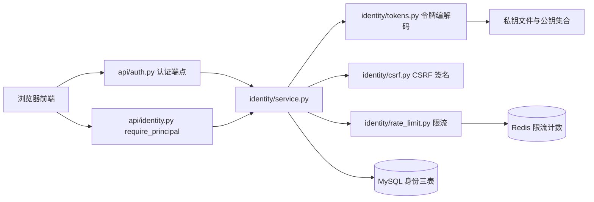
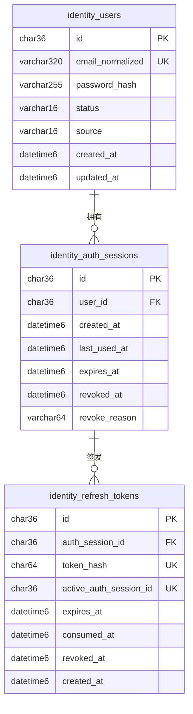
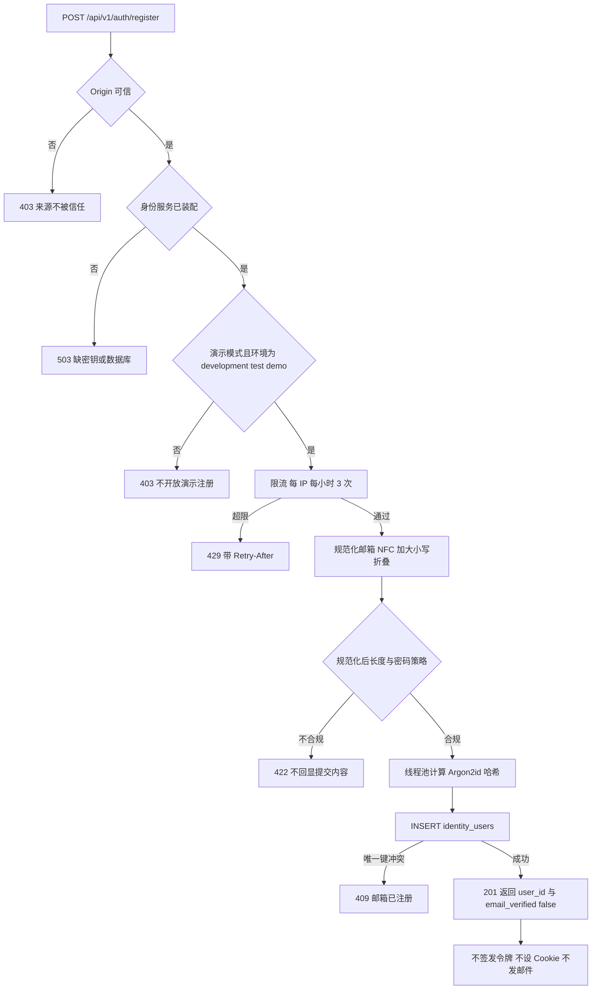
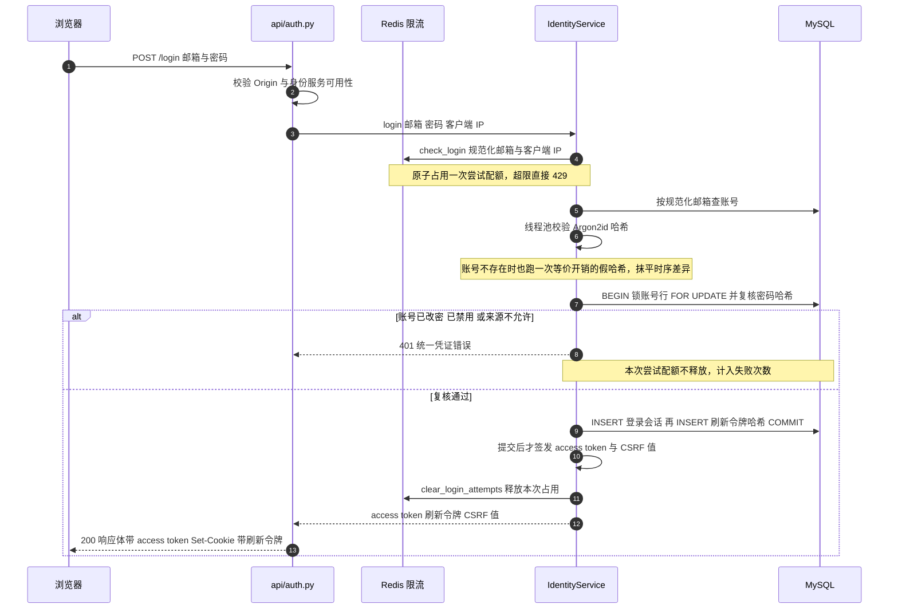
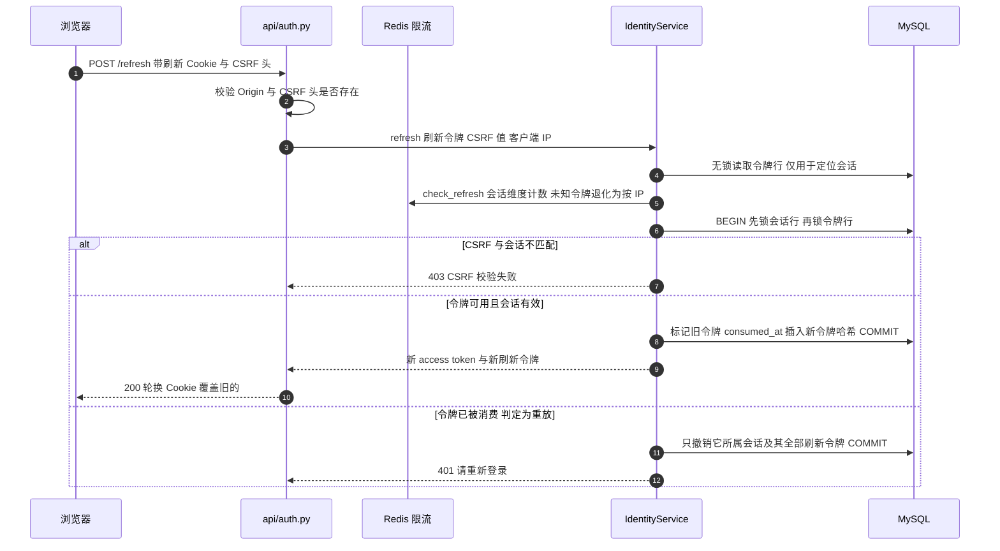
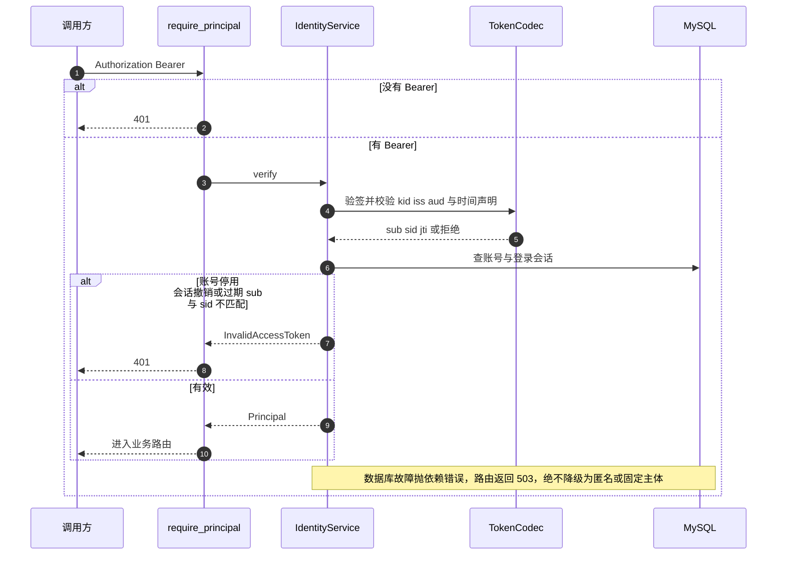
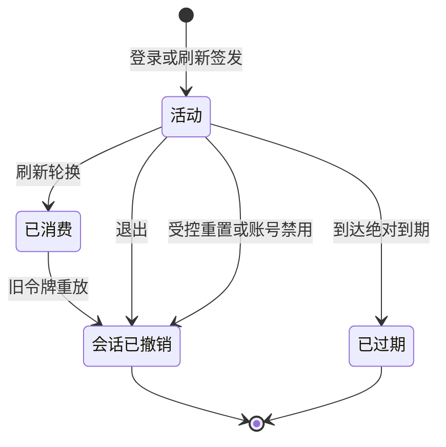
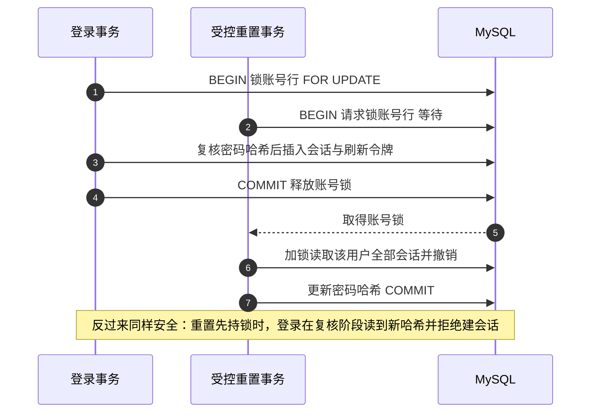

# 电商 Agent 身份模块设计（演示版）

日期：2026-09-29

状态：评审稿

关联设计：[电商 Agent MVP 架构与交易交接设计](2026-09-29-commerce-agent-mvp-design.md)。本稿定义 `identity/` 如何产生和验证可信主体；购物会话、购物车归属及宿主交接仍以关联设计为准。

## 1. 目标和演示边界

项目目前没有身份服务，旧推荐请求的 `user_id` 由调用方填写，不能证明请求者身份。购物 MVP 要按真实主体隔离会话、购物车和确认动作。本期在同一 FastAPI 应用中建设 `identity/` 模块，沿用 MySQL、SQLAlchemy 异步会话和 Alembic；向购物域提供异步的 `IdentityProvider.verify(token) -> Principal`。

**演示版的邮箱只是登录名，不验证邮箱所有权。** 注册提交邮箱和密码，在本地创建账号；登录用密码校验该账号，不发送邮件，不接 SMTP，不发送验证码，也没有“验证邮箱”“忘记密码”接口。演示注册仅在显式 `identity_demo_mode=true` 的隔离环境开放；正式环境必须拒绝这种自助注册。演示版能验证“持有已注册账号密码的人”，不能证明其控制该邮箱，也不能作为对外开放的真实用户账号系统。需要真实用户注册时，另设计邮箱所有权验证和账号恢复流程。本稿不要求实现这些流程。

这里的“模拟”仅限账号来源和邮箱验证：密码哈希、登录校验、令牌签发与验证、会话撤销、主体归属均走真实代码与持久化数据。不得用任意邮箱、请求体 `user_id`、固定开发主体或跳过密码检查来签发购物访问令牌。测试可注入受控 `Principal`，但生产配置不能启用测试替身。

## 2. 方案及模块边界

| 方案 | 取舍 | 决定 |
| --- | --- | --- |
| 本地演示账号 + 短期 JWT + 服务端登录会话 | 无需邮件服务；保留 Bearer API 契约并可验证跨用户隔离；演示账号没有邮箱归属证明 | **采用**，仅供内部演示和联调。 |
| 固定令牌或前端直接传 `user_id` | 简单，但任何调用方都能冒充其他用户 | 不采用。 |
| 完整邮箱注册、验证和找回 | 可支持真实邮箱归属和恢复，但需要邮件投递、重试和滥用防护 | 留给真实用户上线阶段单独设计。 |

`identity/` 管理演示账号、密码哈希、登录会话、访问令牌、刷新令牌、撤销和安全审计；`api/auth.py` 管理 HTTP、Cookie、CSRF、输入和错误映射；`api/commerce` 只使用 `require_principal` 返回的 `Principal`。Agent 不接触密码、原始令牌或账号查询工具。JWT 只用于本项目 API，不代表本项目提供通用 OAuth/OIDC 授权服务。

## 3. 数据模型和主体

表由 Alembic 创建；主键使用应用生成的 UUID `CHAR(36)`，时间使用 UTC `DATETIME(6)`。不在应用启动时自动建表。

| 表 | 字段与约束 | 用途 |
| --- | --- | --- |
| `identity_users` | `id` 主键、`email_normalized` 唯一、`password_hash`、`status=active/disabled`、`source=demo`、`created_at`、`updated_at` | `id` 是不可变主体；邮箱只作登录名，不标记为已验证，也不作为购物车归属键。规范化规则是去首尾空白、Unicode NFC 和大小写折叠，不做邮箱商特定的点号或别名折叠。 |
| `identity_auth_sessions` | `id` 主键、`user_id` 外键、`created_at`、`last_used_at`、`expires_at`、`revoked_at`、`revoke_reason` | 一次设备登录。建议绝对有效期 30 天，不因刷新无限延长；退出或禁用账号后失效。 |
| `identity_refresh_tokens` | `id` 主键、`auth_session_id` 外键、`token_hash` 唯一、`expires_at`、`consumed_at`、`revoked_at`、`created_at` | 不透明随机令牌至少 256 位；只存 SHA-256 哈希。已消费行保留至会话到期，用于发现重放。每个会话最多一枚活动令牌，以活动行生成列唯一索引和事务行锁保证。 |

密码使用 Argon2id 哈希，至少配置 `m=19456 KiB, t=2, p=1`，库为每个密码生成独立盐；密码或原始刷新令牌不落库、不入日志。密码至少 15 个字符，允许至少 64 个字符及空格/Unicode，不要求固定字符组合。演示版没有自助找回密码；忘记密码只能在隔离环境通过受控运维命令重置，重置时撤销该用户全部登录会话，不能由前端任意指定账号执行。

本服务配置稳定 `issuer` 和仅指向电商 API 的 `audience`，`subject` 使用 `identity_users.id`。`Principal(issuer, subject, principal_key)` 中的 `principal_key` 对 `issuer` 和 `subject` 的 UTF-8 字节分别加 4 字节大端长度前缀，串接后取 SHA-256 十六进制摘要；邮箱不参与。该键写入购物会话、购物车和交接记录。更换 `issuer` 时必须迁移主体映射，不能直接修改配置使旧车失联。

## 4. 注册、登录、刷新与验证

1. **演示注册**：`POST /api/v1/auth/register` 仅在 `identity_demo_mode=true` 且部署环境标记为 `development/test/demo` 时可用；提交邮箱和密码，规范化邮箱并保存 `source=demo` 的账号和密码哈希。邮箱重复返回冲突；页面明确标记“演示账号，邮箱未验证”。接口不发送邮件，也不自动登录。正式环境即使误设开关也拒绝启动或拒绝该端点。
2. **登录**：`POST /api/v1/auth/login` 按邮箱查账号并验证密码。不存在账号、密码错误和禁用账号对外使用相同的凭证错误，避免枚举。成功后创建服务端登录会话和第一枚刷新令牌；事务提交后返回短期 access token 并设置刷新 Cookie。正式环境不接受 `source=demo` 的账号登录。
3. **访问令牌**：登录或刷新签发固定 `RS256` 的 JWT，默认有效期 15 分钟，含 `iss`、`aud`、`sub`、`sid`、`iat`、`nbf`、`exp`、随机 `jti`，头部带本服务配置的 `kid`。私钥由部署密钥管理提供；只按服务端配置的公钥集合和固定算法验签，不接受 `alg=none` 或令牌指定的密钥 URL。轮换时先分发新公钥，再切换签发私钥；旧公钥保留至全部旧令牌过期并越过时钟容差。
4. **每次请求验证**：FastAPI `require_principal` 提取 Bearer 令牌，经 `IdentityProvider.verify` 校验签名、`kid`、`iss`、`aud`、时间字段、非空 UUID `sub` 和 `sid`，再查 MySQL，确认账号与登录会话匹配、状态有效、未撤销且未过期。即使 JWT 尚未过期，退出或禁用账号也应立即生效。无效凭证返回 401；数据库或密钥故障返回 503，不降级为匿名或固定主体。
5. **刷新**：`POST /api/v1/auth/refresh` 从刷新 Cookie 取令牌，以哈希定位记录；事务内锁会话与令牌，核对账号状态、时效和消费状态，消费旧令牌并保存新令牌，提交后返回新 access token 和刷新 Cookie。刷新令牌不能超过登录会话绝对到期时间。已消费令牌重放时撤销该会话；未知令牌不能触发对其他会话的撤销。客户端收敛并发刷新；若多标签页竞争导致撤销，重新登录。
6. **退出**：`POST /api/v1/auth/logout` 撤销当前登录会话和所有剩余刷新令牌，清除 Cookie。账号禁用和受控密码重置撤销该用户全部登录会话。

登录与注册按规范化邮箱和可信客户端 IP 在 Redis 中原子限流；演示默认登录每邮箱每 15 分钟 5 次失败、每 IP 每 15 分钟 30 次失败，注册每 IP 每小时 3 次，刷新每会话每分钟 30 次。触发后返回 429 与 `Retry-After`。Redis 不可用时这些端点拒绝服务。仅信任配置的反向代理提供的客户端 IP；不直接信任任意 `X-Forwarded-For`。安全审计记录失败次数、撤销和重放，不记录密码或原始令牌。

## 5. 浏览器及 HTTP 契约

默认前端与 API 在同站点 HTTPS。前端只在内存中保存 access token，调用购物 API 时发送 `Authorization: Bearer <access_token>`。刷新令牌放在带 `__Host-` 前缀、`Secure`、`HttpOnly`、`SameSite=Lax`、`Path=/`、无 `Domain` 的 Cookie，不放 `localStorage` 或 `sessionStorage`。登录响应给出当前会话的 CSRF 值；页面重载后先调用 `GET /api/v1/auth/csrf`，服务端凭刷新 Cookie 定位有效会话，返回与之绑定的签名 CSRF 值，再调用 `/refresh`。登录、注册、刷新、退出检查可信 `Origin`，刷新和退出还校验自定义头里的 CSRF 值。生产 CORS 仅允许明确配置的前端来源，不用 `*`。

| 端点 | 请求 | 成功结果 |
| --- | --- | --- |
| `POST /api/v1/auth/register` | 邮箱、密码；仅演示环境 | 演示账号 ID；无邮件、无自动登录 |
| `POST /api/v1/auth/login` | 邮箱、密码 | access token、过期时间、CSRF 值；设置刷新 Cookie |
| `GET /api/v1/auth/csrf` | 刷新 Cookie | 当前会话的 CSRF 值 |
| `POST /api/v1/auth/refresh` | 刷新 Cookie、CSRF 值 | 新 access token；轮换刷新 Cookie |
| `POST /api/v1/auth/logout` | 登录凭证、刷新 Cookie、CSRF 值 | 撤销会话并清除 Cookie |
| `GET /api/v1/auth/me` | Bearer access token | 用户 ID、登录邮箱、`email_verified=false`、账号来源 |

所有认证响应禁止缓存，不把令牌放 URL；请求体和日志不得记录密码、刷新令牌。Cookie 只用于认证端点，购物端点仍要求 Bearer。浏览器演示环境也使用 HTTPS，以保证刷新 Cookie 的 `Secure` 和 `__Host-` 属性有效。

第 4、5 节描述的流程与状态的图示见第 7 节；各项技术选择的取舍见第 8 节。

## 6. 购物边界、验证和后续升级

购物会话建议 24 小时有效，按 `principal_key` 归属；它不等于登录会话。刷新 access token 后同一主体可继续未过期购物会话，购物会话过期不删除购物车。所有车、动作和交接记录在 API 与服务层按主体双重校验。旧推荐接口的 `user_id` 保持兼容，但绝不能作为新交易入口的身份依据。宿主读取交接快照仍需独立服务凭证，不能把用户 JWT、`handoff_id` 或 URL 当作宿主服务身份。

配置包含稳定 `issuer`、`audience`、签名密钥来源与 `kid`、CSRF 签名密钥、令牌/会话时效、允许来源、Redis 限流和 `identity_demo_mode`；`.env.example` 仅保留占位符。正式环境禁止演示账号登录及自助注册，缺少密钥、MySQL、Redis 或可信前端来源时受保护端点不可用。开发/测试使用隔离数据库、临时密钥和演示账号；固定 `Principal` 只用于单元测试。当前设计不将演示注册视为生产身份交付。

验收覆盖：注册无邮件依赖、邮箱重复与并发唯一约束、错误密码/不存在/禁用账号的统一失败响应、演示模式在正式环境不可用、JWT 错误签名/算法/受众/签发方/过期拒绝、退出与密码重置后旧 JWT 立即失效、刷新轮换和旧令牌重放、跨用户读车/确认/交接拒绝、Redis 故障拒绝、Cookie/CSRF/CORS 配置。端到端演示从注册和密码登录取得 access token；不能用固定 `Principal` 冒充完整身份链路。

真实用户上线另需设计邮箱所有权验证、账号恢复、滥用处置与运维支持。引入这些能力前，不对外宣称邮箱已验证，也不把演示账号视为可供真实交易使用的生产身份。演示账号及其购物车不自动迁移为正式账号；若未来需要迁移，须另设计主体映射和归属证明。安全选择参考 [OWASP Password Storage](https://cheatsheetseries.owasp.org/cheatsheets/Password_Storage_Cheat_Sheet.html)、[OWASP Authentication](https://cheatsheetseries.owasp.org/cheatsheets/Authentication_Cheat_Sheet.html) 与 [OWASP Session Management](https://cheatsheetseries.owasp.org/cheatsheets/Session_Management_Cheat_Sheet.html)。

## 7. 图示

图中的顺序、分支与失败语义与实现一一对应；标注「实现补充」的地方是设计稿定稿后为消除竞态而收紧的行为。

### 7.1 组件与依赖

身份模块只依赖 MySQL、Redis 与密钥文件三样东西。购物域拿到的只有 `Principal`，不接触密码、令牌或账号查询；购物会话与购物车归属由购物域按 `principal_key` 自行过滤（第 6 节）。

### 7.2 数据模型

`active_auth_session_id` 是生成列：未消费且未撤销时等于 `auth_session_id`，否则为 `NULL`。它在唯一索引上表达「每个登录会话最多一枚活动刷新令牌」——MySQL 没有部分索引，这是最接近的等价物，且唯一索引允许多个 `NULL`，同一会话的历史行不会互相冲突。

### 7.3 演示注册

并发注册同一邮箱只可能有一个成功者：唯一索引在数据库层裁决，另一个收到 `IntegrityError` 并返回 409。

### 7.4 密码登录

**实现补充**：设计稿初稿的登录是「读账号 → 验密码 → 另开事务建会话」。这中间存在窗口——受控重置可以提交在两步之间，让这次用旧密码建立的会话躲过撤销。现在把「锁账号行 + 复核密码哈希 + 建会话」放进同一个事务，重置则在更新密码前先取得同一行的锁，两者因此严格串行（见 7.8）。

### 7.5 刷新轮换与重放

并发刷新只有一个赢家：两个事务在会话行上串行，后到者看到「已消费」，按重放处理并撤销会话（客户端应自行收敛并发刷新，若因多标签页竞争被撤销则重新登录）。未知令牌不会触发对任何会话的撤销。

### 7.6 逐请求验证

`verify` 是只读路径：`last_used_at` 只在刷新与退出时更新，避免每个受保护请求都写库。

### 7.7 会话与刷新令牌状态

会话绝对到期 30 天，不因刷新延长；刷新令牌不得超过所属会话的到期时间。撤销发生在会话维度：会话一旦撤销，其名下所有刷新令牌同时作废。

### 7.8 登录与受控重置的并发顺序

这是第 7.4 节「实现补充」的并发视图。两处的锁顺序都是「先账号行、后会话行」，不存在环，因此不会死锁。

## 8. 技术选型与权衡

### 8.1 决策一览

| 决策 | 采用 | 放弃的方案 | 代价 | 何时重新评估 |
| --- | --- | --- | --- | --- |
| 身份来源 | 自建 `identity/` 演示账号 | 固定令牌、请求体 `user_id`、通用 OIDC | 邮箱所有权未验证，不能当生产身份 | 面向真实用户上线，需要账号归属与找回 |
| 访问令牌 | 签名 JWT RS256 | 不透明令牌 + 内省、HS256 | 密钥管理复杂，且仍需每请求查库 | 需要在网关独立验签，或要缩短撤销检查延迟 |
| 撤销检查 | 每请求查 MySQL | 纯无状态 JWT、Redis 缓存撤销状态 | 每请求一次数据库读 | 认证端点 QPS 成为 MySQL 瓶颈时（可加短 TTL 的撤销缓存） |
| 密码哈希 | Argon2id m=19456 t=2 p=1 | bcrypt、scrypt、PBKDF2 | 单次校验几十毫秒 CPU，是 DoS 面 | 硬件换代后可上调参数并重新哈希 |
| 会话存储 | MySQL 三表 + 生成列唯一索引 | Redis 存会话、单表合并 | 多一次查询；生成列可读性差 | 撤销检查改为缓存后，可重新考虑存储 |
| 限流 | Redis 原子占用 | 进程内计数、网关限流、MySQL 计数 | Redis 成为认证可用性单点（fail-closed） | 需要区分「网关粗粒度 + 应用细粒度」两层时 |
| 浏览器凭证 | access 存内存、refresh 进 `__Host-` Cookie | 双 Cookie、localStorage、BFF | 仍需 CSRF 防护与前端状态管理 | 前端改为 BFF 架构，Cookie 可换成同站不透明会话 |
| CSRF | 会话绑定的无状态 HMAC | 双提交 Cookie、服务端 synchronizer token | 会话内恒定，泄露窗口较长 | 需要按请求一次性令牌时 |
| 主键 | UUID `CHAR(36)` | `BINARY(16)`、自增 `BIGINT` | 索引更大，随机写入不连续 | 单表行数进入千万级 |
| 演示模式 | 环境白名单 + 配置开关双条件 | 只看配置开关 | 配置写错即端点不可用（503） | 不再需要演示账号时整体删除 |

### 8.2 访问令牌：签名 JWT 与不透明令牌

选 JWT 的理由是**验签不需要共享秘密**：公钥可以分发给网关或其他服务，私钥只留在身份服务。换成 HS256 会让每个验签方都持有等同签发权的密钥，泄露面随验签方数量线性放大。

代价是两件事。一是密钥管理：需要 `kid`、公钥集合和轮换流程，配置错误必须在装配阶段就暴露（缺当前 `kid`、私钥与公钥不配对、PEM 损坏都在启动时报配置错误，而不是等到签发）。二是「算法固定」必须显式落实：只接受 `RS256`，`kid` 必须在服务端配置的公钥集合里，绝不使用令牌自带的 `jku`/`jwk`。

不透明令牌 + 内省是等价的替代方案。它的优势是令牌本身不含信息、天然可即时撤销；代价是每次验证都要一次内省调用，且内省本身又需要一个共享存储。本项目已经要查库做撤销检查，内省不会省掉这次往返，因此没有选它。

### 8.3 无状态 JWT 的收益只兑现了一半

这是本模块最值得说明的取舍：**令牌是无状态的，但撤销不是。**

代价很直接：每个受保护请求都要查一次 MySQL。收益是撤销即时生效——退出、禁用账号、受控重置后旧 JWT 立刻失效，不需要等它自然过期，也不需要维护黑名单。

如果选择纯无状态（只验签、不查库），代价是撤销延迟最长等于令牌有效期（15 分钟）。对内部演示可以接受，对交易链路不可接受，所以这里主动付了这次查询。

真正需要缩短的是「每次查库」的成本，而不是放弃即时撤销。届时的选项按代价排序：给撤销状态加一层很短的缓存（几秒 TTL，权衡的是撤销延迟）；把账号与会话的校验字段做成窄查询；或改用不透明令牌 + 内省并把内省本身做缓存。

### 8.4 密码哈希：Argon2id 与参数

Argon2id 是 OWASP 当前的首选（抗 GPU 与抗侧信道兼顾），`argon2-cffi` 的后端是 C 实现。参数取 `m=19456 KiB, t=2, p=1`，是 OWASP 推荐的最低配置之一：内存开销是主要防线，时间开销控制在单次几十毫秒，让登录按钮不至于难以忍受。

由此带来两个必须处理的后果：

- **不能阻塞事件循环**。校验放在线程池里执行，否则一次登录会卡住整个进程的所有请求。
- **hash 计算本身就是 DoS 面**。并发登录可以打满线程池，所以限流必须先在入口拦住（见 8.6），且账号不存在时也跑一次等价开销的假哈希——那既是为了抹平时序差异，也让攻击者无法通过「快 = 账号不存在」来枚举。

密码策略只限定长度（15–128 字符，允许空格与 Unicode），不强制字符组合：组合规则会诱导用户写出可预测的变体，长度才是主要变量。

### 8.5 会话与刷新令牌：为什么落在 MySQL

登录会话与刷新令牌属于**状态**，不是缓存：丢了要么把所有人踢下线，要么更糟——刷新令牌的消费记录丢失就无法发现重放。因此它们落在 MySQL，和目录、价格、库存一样走事务与约束，而不是放进 Redis。Redis 在这个模块里的职责被严格限定为「可以丢的计数器」。

「每个会话最多一枚活动令牌」用生成列加唯一索引表达，而不是应用层加锁：应用层锁在多实例下无效，行锁只能保护已经定位到的行、保护不了「不存在的那一行」。生成列把「什么算活动」这条规则交给数据库，插入第二枚活动令牌时唯一索引直接拒绝，并发下不需要额外的协调。

代价是迁移里多了一个表达式列，可读性差一些，且必须是 STORED 生成列（虚拟列上的唯一索引对扫描与复制有额外限制）。规则的形状是 `CASE WHEN consumed_at IS NULL AND revoked_at IS NULL THEN auth_session_id ELSE NULL END`，因为唯一索引允许多个 `NULL`，历史行不会互相冲突。

### 8.6 限流：Redis 与 fail-closed 的可用性代价

限流状态必须跨实例共享，判定必须原子，且仓库里已经有 Redis（`services/feature_store.py` 在用），因此选 Redis。用 Lua 把「计数」与「判定」合成一次原子操作，而不是先读后写：多实例下先检查后计数会让并发请求同时读到未超限的旧值一起放行，等于把上限按并发度放大。

**实现补充**：`check_login` 采用占用法——入口处原子自增并判定，登录成功后释放（`DECR`，归零即删）。失败的尝试一直计入，因此「每邮箱 15 分钟 5 次失败」在并发下也是硬上限；成功登录不消耗配额，正常用户不会因为登录次数多而被锁。`record_login_failure` 保留给没有先占用配额的调用方补记。

**最重要的取舍不是技术选型，而是故障语义**：Redis 不可用时选择拒绝服务（fail-closed，返回 503），而不是「读不到计数就放行」。后者等于把限流开关交给 Redis 的可用性。代价是 Redis 成为认证端点的可用性单点，缓解手段是分层：

- 网关承担第一层粗粒度 IP 限流（抗扫描与暴力破解），应用层只做业务维度（邮箱、会话、注册）。这样 Redis 故障时损失的是精确度，而不是裸奔。
- 限流用独立实例或独立 DB，`maxmemory-policy` 设 `noeviction`。和缓存混用且允许驱逐时，内存吃紧会静默淘汰计数键，限流被绕过且没有任何告警。
- 测试环境不能对共享实例执行 `FLUSHDB`：只清理自己的键前缀。本仓的限流测试夹具就是这么做的。

其余已知边界：固定窗口在窗口交界处最坏允许两倍突发（要平滑就上令牌桶或 GCRA）；单个被攻击的邮箱或 IP 会把流量压到同一个键，构成热点分片；每维度的脚本只带一个 key，因此天然兼容 Redis Cluster，若将来把多维度合并进一条脚本，则需要 hash tag 保证同槽。

### 8.7 浏览器凭证与 CSRF

access token 只存内存，刷新令牌进 `__Host-` + `Secure` + `HttpOnly` + `SameSite=Lax` Cookie，`Path=/` 且不带 `Domain`。这是在两类风险之间取平衡：access token 放 `localStorage` 会被 XSS 直接读走；刷新令牌放 `localStorage` 等于给攻击者一个可长期续期的凭证。放进 HttpOnly Cookie 后 XSS 读不到，但浏览器会自动携带，于是需要 CSRF 防护——这就是同一个决定的两面。

CSRF 值选**会话绑定的无状态 HMAC**（`HMAC(独立密钥, 会话 ID)`）而不是服务端 synchronizer token：不需要为它建表或占 Redis，不随刷新轮换，跨实例天然一致。代价是同一会话内值恒定，泄露后的有效窗口等于会话剩余寿命；缓解手段是 `SameSite=Lax`、`Secure`、写操作校验 `Origin`，以及值本身只能通过需要 Cookie 的接口取得——跨站请求读不到响应体。要收紧到一次性令牌时，再引入服务端存储。

认证写接口校验 `Origin`：带了 `Origin` 但不在白名单一律拒绝，没带则视为非浏览器发起（浏览器跨站提交必然带 `Origin`）。CORS 只允许显式配置的来源，且绝不用 `*`——`allow_credentials=true` 与通配来源互斥。

### 8.8 主键与时间

主键用应用生成的 UUID `CHAR(36)`：便于运维与排障（可直接贴进日志和工单），迁移与数据修复不需要协调自增序列，也不会把「用户数量」暴露在 URL 里。代价是索引比 `BINARY(16)` 大一倍多，随机写入导致页分裂。演示规模下这些都不构成问题；若单表进入千万级，再评估改成 `BINARY(16)` 存储、对外仍以字符串呈现。

时间统一用 UTC `DATETIME(6)`，由应用写入，不依赖数据库会话时区；对外输出的时间字段带 UTC 标识，避免被按服务器本地时间误读（本机是 UTC+8，裸时间会直接差 8 小时）。

### 8.9 依赖故障语义

| 故障 | 行为 | 是否降级 |
| --- | --- | --- |
| MySQL 不可用 | 认证端点、受保护路由、目录与报价等依赖数据库的接口各自 503；旧推荐接口不依赖数据库，照常服务 | 否，绝不视为匿名 |
| Redis 不可用 | 注册、登录、刷新 503 | 否，绝不「读不到计数就放行」 |
| 签名私钥缺失、不可解析或与当前 `kid` 不配对 | 身份服务不装配；认证端点为 503，应用仍可启动 | 否 |
| 公钥集合缺当前 `kid`，或含无法解析的公钥 | 同上 | 否 |
| 可信前端来源未配置 | 带 `Origin` 的认证写请求 403，CORS 不返回允许头 | 否 |
| 部署环境为 `production` 却开启演示模式 | 身份服务拒绝装配 | 否 |
| 签发方与验签方的时钟偏移 | 30 秒容差内的 `iat`/`nbf`/`exp` 仍接受，超出即拒绝 | 是，受控容差 |

表中「否」的含义是：没有任何一条路径会把依赖故障变成「以匿名身份继续」或「以固定主体继续」。这是本模块与其他只读模块最大的区别——只读模块可以降级返回空列表，身份不能。
