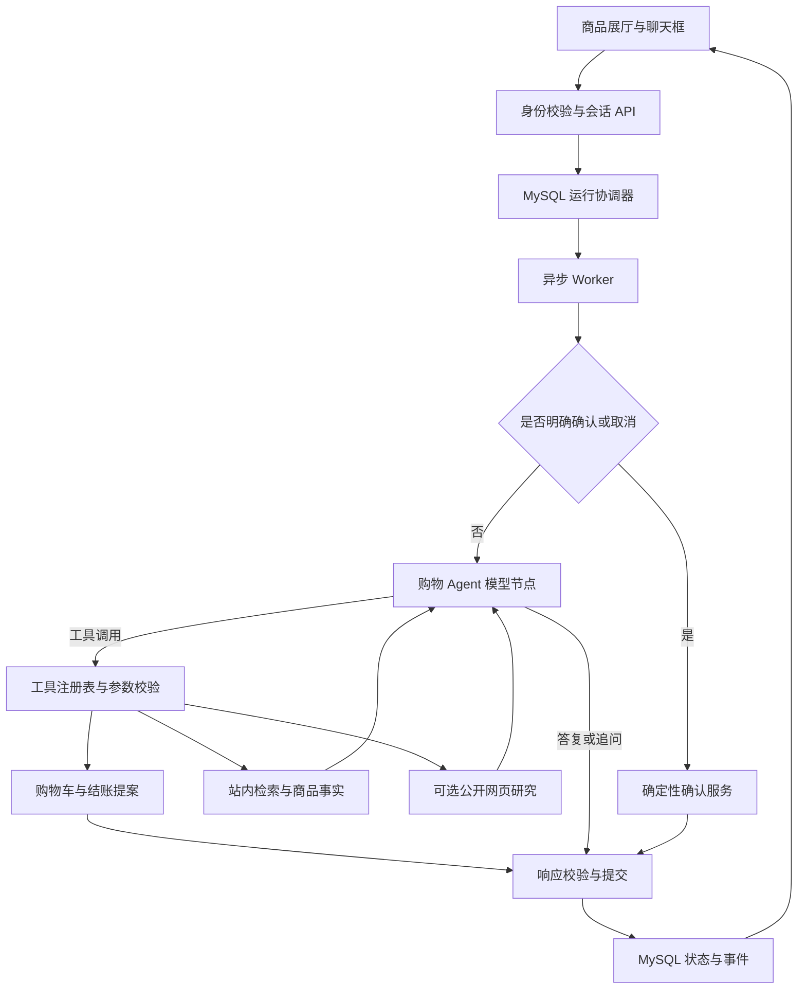

# 对话式购物 Agent 设计

日期：2026-10-01

状态：待用户审阅；本文定义目标设计，不表示功能已经实现。

代码基线：主仓库 `python` 分支，`4ea1327`。

## 1. 目标与范围

用户通过一个聊天框表达需求，Agent 自主决定何时追问、搜索商品、查详情、核验、比较和调整推荐。商品展厅承担浏览、展示结果和引用商品的作用；用户不需要填写类目、检索词或预算表单。前端沿用已完成的 React + TypeScript + Vite 桌面展厅和可隐藏的会话侧栏。

核心选择是：**一个带工具调用循环的购物 Agent，配合持久化任务运行器和确定性交易服务。** 模型负责判断下一步需要获得什么信息；领域服务负责事实、权限、金额、库存、确认和业务写入。

“理解需求 → 必要时追问 → 检索 → 核验推荐 → 根据反馈调整”描述用户体验，不是要求每轮依次走完的固定工作流。例如用户给出两件商品时，Agent 可以直接查询详情和报价并比较；发现缺少关键规格时，可以补查或追问；用户修改预算后，可以重新检索。

### 1.1 本次设计对应的第一阶段

第一阶段形成一条可评测的站内购物闭环：

1. 从中文自然语言和商品引用中理解需求，跨轮保留明确条件。
2. 动态调用站内搜索、详情、报价、比较和购物车查询工具。
3. 检索真实导入商品，展示有依据的推荐、取舍和未知信息。
4. 在用户选择商品后提出购物车操作或结账交接，沿用明确确认。
5. 持久化执行进度，支持追问、等待确认、页面刷新和服务重启后的恢复。
6. 建立基于最终业务状态的任务评测，而非只评价回答是否流畅。

第一阶段同时定义只读网页研究接口。部署配置了搜索提供方时可启用，用于解释品类知识和查阅公开资料；未配置时能力清单明确标记不可用，站内闭环仍能独立验收。网页研究启用前必须通过独立的来源、注入和网络边界测试。

### 1.2 后续阶段边界

| 阶段 | 能力 | 与本阶段的关系 |
| --- | --- | --- |
| A：本次设计 | 站内动态购物 Agent、任务恢复、交易提案与确认、任务评测；可选只读网页研究 | 形成独立实施计划和验收闭环 |
| B：外部商品研究 | 跨商家同款识别、结构化报价比较，必要时使用浏览器读取页面 | 复用工具与证据契约，另写设计及计划；不把网页搜索等同于比价已经完成 |
| C：长期任务 | 定时价格检查、条件触发、通知和任务管理 | 需要调度器、授权范围、有效期和通知机制，另写设计及计划 |

本阶段不实现真实付款、订单履约、退款、多 Agent 分工、开放式电脑控制或无人值守购买。已有 checkout 仍是演示性交接。多类目套装的联合预算优化不纳入 A；遇到此类请求先说明当前范围，再由用户选择一个购买目标。

## 2. 当前实现与差距

以下是当前代码事实，区别于后文建议。

| 当前实现 | 限制 | 本设计的改变 |
| --- | --- | --- |
| [`graph.py`](../../../commerce_orchestrator/graph.py) 是无 checkpointer 的单轮 `StateGraph`，按路由进入固定节点 | 模型不能依据工具结果自行决定继续查什么 | 图中增加有上限的 `model → tools → model` 循环 |
| [`model.py`](../../../commerce_orchestrator/model.py) 只接收软偏好、用途和候选 ID 排序 | 自由文本中的检索需求和复杂反馈无法充分表达 | 引入结构化约束提案、工具调用和结果契约 |
| [`discovery.py`](../../../commerce_orchestrator/discovery.py) 在有限扫描后按价格等条件选出最多 3 个商品，再交给模型排序 | 相关候选可能在模型介入前已丢失 | 混合召回、事实核验后，给模型更大的候选池 |
| [`catalog/service.py`](../../../catalog/service.py) 的现有文本搜索主要匹配商品名称和编码 | 英文资料与中文购物表达之间存在差距 | 增加检索文档、词法与多语言语义召回 |
| [`compare.py`](../../../commerce_orchestrator/compare.py) 和选择流程使用有限扫描判断候选是否合格 | 已明确指定但落在扫描窗口外的商品可能被排除 | 按指定 ID 直接读取与核验，不依赖其搜索排名 |
| [`shopping_session/`](../../../shopping_session/) 保存约束、轮次响应、已展示商品和执行租约 | 尚无完整工具执行日志、任务状态和服务器会话消息历史 | 增加任务、运行和步骤记录，复用现有轮次与租约边界 |
| [`cart/`](../../../cart/) 与 [`checkout/`](../../../checkout/) 已有提案、确认、版本及幂等机制 | Agent 扩展容易绕开既有门禁 | 新工具只能调用这些领域服务，确认在模型循环外执行 |
| [`infrastructure/milvus_client.py`](../../../infrastructure/milvus_client.py) 已采用 `AsyncMilvusClient` | 当前封装仅有连接、探活和关闭，不能据此宣称混合检索已经接通 | 新增向量生成、索引同步、查询和质量验证 |

[`api/runtime.py`](../../../api/runtime.py) 会在配置模型 Key 时注入现有 LLM 适配器。是否配置 Key、是否支持工具调用、是否实际完成一次模型请求是不同事实；新能力上线必须有真实工具调用的冒烟验证，不能用页面可访问作为接入证明。

本设计替代[原 Commerce MVP 设计](./2026-09-29-commerce-agent-mvp-design.md)中的固定购物编排方式；保留其身份、商品事实、确认与幂等约束。展厅交互继续遵守[已审阅的前端设计](./2026-10-01-commerce-storefront-design.md)。

## 3. 架构选择与取舍

### 3.1 Agent 范式

| 方案 | 优点 | 代价与适用性 |
| --- | --- | --- |
| 扩展固定 workflow | 可预测、调用少、容易覆盖分支 | 每增加一种购物表达都需要增加路由，难以处理调查和反复比较 |
| 单 Agent 动态工具循环 + 确定性服务，选用 | 根据观察调整下一步，工具链可追踪，复用现有服务 | 延迟和成本更不稳定，需要循环上限、恢复与任务评测 |
| 多专业 Agent 或通用浏览器 Agent | 适合更广的分工和跨站操作 | 当前没有明确的独立职责收益，却增加交接、上下文与权限复杂度 |

选用 **ReAct 风格的结构化 tool calling**：模型产生工具调用，运行器执行并返回观察，模型再决定下一步。无需额外调用一次模型生成公开“思考过程”，也不保存或向前端展示模型的私有推理；保存工具名称、受控参数、结果摘要、证据和用户可读的进度即可。

继续使用 LangGraph 和现有异步模型适配器。LangGraph 可表达动态循环，采用它并不意味着必须使用固定 workflow；参考[官方对 workflows 与 agents 的区分](https://docs.langchain.com/oss/python/langgraph/workflows-agents)。不引入另一套 Agent 框架，不因参考仓库使用 Claude 或 Microsoft Agent Framework 而强制迁移模型供应商。

### 3.2 持久化与运行方式

选择 **MySQL 任务与步骤日志 + 独立异步 worker**。LangGraph 负责单次运行中的循环，MySQL 负责跨进程恢复和业务提交边界。

备选方案是直接采用 LangGraph checkpointer/`interrupt`。它更方便保存图状态，但本项目已有 MySQL 轮次、租约和业务确认；再建立独立 checkpoint 真相源，会增加状态一致性问题。因此 A 阶段借鉴 HelpPilot 的“暂停后持久化、依据明确输入恢复”语义，自行定义少量持久化状态，不同时维护第二套 checkpoint。

这意味着需要自行实现步骤恢复与租约续期，但故障模型更接近现有代码。若以后改用官方 checkpointer，需另行设计与业务事务的衔接；不能把启用 `interrupt` 当作自动获得写入幂等。官方文档也要求恢复时考虑节点重放，见 [LangGraph interrupts](https://docs.langchain.com/oss/python/langgraph/interrupts)。

### 3.3 检索方案

选择 **MySQL 词法检索 + Milvus 向量检索 + 应用层 RRF 融合**。业务数据留在现有 MySQL，Milvus 只存可重建的检索索引。

迁移到 PostgreSQL/pgvector 可以统一部分检索能力，但会扩大业务数据库迁移范围；另建 OpenSearch 提供更多词法搜索能力，却增加运维系统。本阶段先验证现有技术栈的召回质量，保留以后替换 `CatalogSearch` 适配器的空间。

MySQL 使用独立检索文档表的 `FULLTEXT`，现有商品编码、品牌等精确匹配另走确定性查询。官方支持 InnoDB 全文索引；中文分词能力不能替代跨语言语义检索，见 [MySQL 全文检索文档](https://dev.mysql.com/doc/refman/8.4/en/fulltext-search.html)。

## 4. 组件与执行循环



组件职责：

| 组件 | 输入与输出 | 责任边界 |
| --- | --- | --- |
| `RunCoordinator` | 已验证身份、用户轮次 → `run_id`、状态和事件 | 归属、去重、会话互斥、租约、取消、完成提交 |
| `ShoppingAgent` | 用户消息、任务摘要、工具结果 → 下一批工具调用或答复提案 | 判断下一步；不能直接访问数据库或任意网络 |
| `ToolRegistry` | 工具名和结构化参数 → `ToolResult` | 注册白名单、参数校验、调用预算、执行上下文注入 |
| `CatalogSearch` / `CommerceFactsReader` | 查询或商品 ID → 候选与权威快照 | 相关性召回、报价和硬条件核验 |
| `ResponseAssembler` | 答复提案与证据 → 用户答复、商品卡和操作卡 | 拒绝无来源 ID，生成金额和库存展示，原子提交最终状态 |
| `CartService` / `CheckoutService` | 已验证提案或用户确认 → 业务结果 | 业务规则、版本、幂等、实时重查；不依赖模型判断批准 |

一次正常运行：

1. API 校验身份和会话归属，冻结请求内容，创建或返回同一 `run_id`。
2. Worker 获得执行租约，加载当前用户消息、有效约束、最近展示集合、购物车摘要及必要历史。
3. 明确确认、拒绝或取消操作走确定性入口。其他请求进入 Agent 循环。
4. 模型发出工具调用；运行器检查权限和参数，执行，保存结果，再交回模型。
5. 互不依赖的只读调用可并发；约束修改和提案串行。模型不能伪造前一步尚未返回的 ID。
6. 模型决定完成、追问或提出操作。响应组装器核验事实引用，并重新查询准备展示的报价。
7. 单个短事务提交轮次响应、任务状态、消息、已展示集合与完成事件，释放会话执行权。

网页、商品标题、评论、商品描述和工具结果都按不可信数据处理。它们不能增加工具权限、改变确认规则或覆盖系统指令。

## 5. 用户需求、上下文与证据

### 5.1 约束来源

保留 `ShoppingIntent` 作为现有业务服务的约束投影，新增任务级 `RequirementState`：

```text
RequirementState
  goal: 当前购买目标
  constraints[]: field / operator / value / source_turn_id / source_span / strength
  budget: amount_minor / currency / scope(unit | line_total) / quantity
  preferences[]: 偏好、来源、是否经用户确认
  open_questions[]: 阻碍下一步的未决问题
  rejected_product_ids[]: 本任务已排除商品
  last_presented_product_ids[]: 最近一轮已提交的展示顺序
```

`strength` 区分明确硬条件、明确软偏好、推测偏好。模型通过 `update_requirements` 提交结构化修改建议，代码验证字段白名单、类型、来源片段确实存在、数值单位及前后冲突，再更新本轮工作状态。来源片段校验不能证明模型理解正确；“不要低于 500”和“不要超过 500”等方向差异必须有独立用例，无法可靠归一化时追问。

规则：

- 金额使用整数最小货币单位及币种。A 阶段支持单件预算和同一 SKU、明确数量的行总额预算。“总共 1000 买两件同款”记录为 `line_total`；检索可按数量换算单价上限，提案和确认仍由代码检查最终行小计。数量或预算范围有歧义时追问，不能直接映射为每件 1000；不同商品组合的总预算不在本阶段范围内。
- 模型可以提出类目和检索词，类目 ID 必须经目录工具解析；猜测类目不能作为排除商品的硬条件。
- 明确预算、数量、必须具备的属性不能被推测覆盖。用户说“预算提高到 800”可以更新；网页或商品描述无权更新。
- 规格字段只有存在可核验的结构化属性和比较规则时，才作为已满足的硬条件；缺失属性记为 `unknown`，不能当作符合。
- 不为了填全一张表而追问。已有条件能给出有用结果时先检索；影响规格选择、预算含义或交易对象的歧义必须澄清。
- 业务工具使用本轮验证后的约束版本；最终提交时持久化。不能让提案按旧会话预算执行、答复却展示新预算。

### 5.2 商品引用和记忆

“第二个”“刚才的黑色那款”依据最近一次**已提交到会话历史**的商品卡集合和规格解析；不能引用尚未完成的并发工具结果。商品详情中附加到聊天的引用由服务端校验商品/SKU 关系、当前状态和会话归属。

分开保存：

- `run_evidence`：Agent 本轮检索或阅读过的事实，仅支持推理与引用。
- `session_seen_products/skus`：已提交的面向用户结果或经已有 `product-context` 接口确认的商品，继续用于操作门禁；这不是用户已阅读的回执。
- 任务记忆：用户目标、已确认约束、排除项和未决问题。
- 业务事实：每次由目录、报价、库存和购物车服务获取，不从聊天摘要恢复。

搜索返回不等于用户已看过，更不等于用户已选择。A 阶段对“帮我挑一个直接加购”先展示推荐并澄清选择；只有用户选定或明确指向此前已展示的有效 SKU，才创建加购提案。

历史超过上下文预算时，保留当前消息、约束来源、未完成操作和近期商品引用，压缩较旧闲聊。压缩文本不替代结构化约束或业务状态。本阶段不自动建立跨会话长期用户画像。

### 5.3 证据契约

```text
EvidenceRef
  evidence_id
  source_type: catalog | pricing | inventory | cart | web
  entity_id / field_path 或 url / excerpt
  observed_at
  source_revision（适用时）
  data_kind: imported | simulated | live_external
```

模型答复中的商品事实使用证据引用；卡片中的商品名、图片、规格、价格、库存及可操作状态由服务端构造。模型可表达取舍建议，但不能通过自由文本增加无证据的续航、材质、库存或金额。验证器拒绝不存在的引用、跨商品引用、超期的业务快照和越权 ID；对无法机械证明的自然语言归因，在评测中检查，不宣称引用存在就保证语义正确。

[`data/import_amazon_metadata.py`](../../../data/import_amazon_metadata.py) 保留历史美元价格，并生成带标记的模拟价格、库存及默认 SKU。历史 `source_price_usd` 不是当前售价，模拟默认 SKU 不代表真实可选规格。推荐可使用导入资料，但页面和回答必须延续模拟状态说明；数据缺失时保持未知，不能让模型补写进交易事实。

## 6. 工具契约与权限

所有工具由运行器注入 `principal`、`session_id`、`task_id`、`run_id` 和当前执行租约，模型参数中不允许这些身份字段，也不允许任意 SQL、路径、请求头或代码执行。

统一返回：`ToolResult {status, data, evidence_refs, error_code, retryable, truncated}`。`empty`、`unavailable`、`invalid_arguments` 和成功是不同结果；不可把依赖故障伪装成没有商品。

| 工具 | 主要输入 | 输出及限制 |
| --- | --- | --- |
| `update_requirements` | 修改建议、当前消息来源片段 | 验证后的本轮约束；不改业务商品或购物车 |
| `search_catalog` | 查询、已验证过滤条件、分页游标 | 有召回来源的候选与核验摘要；模型不能要求跳过硬过滤 |
| `get_product_details` | 候选或合法引用的商品 ID | 商品、SKU、属性、图片、缺失字段；限定批量大小 |
| `quote_skus` | 合法 SKU、数量 | 服务端报价、库存、可购买性和时间，不接受模型输入价格 |
| `compare_products` | 2–3 个合法商品引用、比较维度 | 按 ID 直查的属性/报价对照，未知项明确返回 |
| `get_cart` | 无身份参数 | 当前主体的购物车与版本；会话限定任务来源和操作权限 |
| `propose_cart_action` | 操作类型、已选择 SKU 或购物车行、数量 | 调用现有服务生成待确认操作；不会直接改购物车 |
| `preview_checkout` | 当前购物车 | 校验后的演示结账交接提案；不付款、不创建真实订单 |
| `web_search`，可选 | 经过裁剪的公开信息查询 | 标题、来源 URL、摘要、检索时间；最多 3 次/运行 |
| `read_web_page`，可选 | 已有来源或用户提供的公开 URL | 限长正文、引用片段、抓取时间；最多 4 次/运行 |

`confirm_action`、实际结账执行、支付、退款、任意 URL 写请求都不注册为模型工具。模型最多在一个用户轮次产生一个购物操作提案；生成后结束工具循环，交给确定性响应组装，避免同轮反复创建或覆盖待确认动作。

最终答复使用结构化 `AnswerDraft`：`kind`、有引用的解释片段、选择的商品 ID、比较维度、问题或待确认动作 ID。`kind` 为 `answer / shortlist / compare / clarify / propose_action / unavailable`。商品卡默认最多 3 个，延续当前展示和比较契约；扩大候选池不意味着强迫前端一次展示几十件商品。

## 7. 商品检索与事实核验

### 7.1 检索管线

```text
原始需求 + 已验证约束
  → 查询归一化（保留品牌、型号、排除项；必要时生成中英文检索变体）
  → 词法召回最多 50 + 向量召回最多 50 + 精确型号候选
  → 按商品 ID 合并，RRF 排名，精确型号作为可解释的排序信号
  → 批量读取商品、SKU、报价与库存，执行硬条件过滤
  → 最多 20 个已核验候选供 Agent 检查、选取或继续检索
  → 展示前重查所选 SKU，输出最多 3 个商品
```

这些数量是初始配置，不是质量保证。RRF 使用排名而非直接相加不可比的向量距离和全文分数；初始 `k=60`，在固定评测集上调参。精确型号仍必须通过价格、状态及库存校验。

过滤后不足时可以扩展召回或让 Agent 改写查询，但不能悄悄放宽预算、换币种或把未知规格当作符合。未知库存商品可作为附明确限制的资料结果，不能成为可购买推荐或操作提案。向量服务失效时回退词法搜索，并在结果中记录 `semantic_unavailable`；这是降级，不算混合检索验收通过。

### 7.2 文档与索引生命周期

新增可重建的 `catalog_search_documents`：商品 ID、标题、品牌、类目路径、可用描述、经过白名单展开的属性文本、`content_hash` 和文档版本。向量文档复用同一文本及 ID，记录 `embedding_model`、维度、版本和生成时间。动态价格、库存不进入向量作为交易判断依据。

使用支持中英文检索的 embedding 适配器。具体模型是部署参数，须通过本项目查询集对相关性、延迟和成本的比较后固定版本；对话模型配置不自动等于 embedding 服务配置。未完成真实索引构建及跨语言召回验证时，只能发布词法降级模式，不能宣称 A 阶段完整验收。

批量索引脚本具备进度、断点、失败记录和版本切换；按内容哈希增量更新，删除或下架商品同步移除。索引任务采用独立小批量事务和并发上限，不在用户请求中对整个目录计算 embedding。A 阶段使用显式批量同步和定期对账；即使索引滞后，所有候选仍需从 MySQL 重新核验，已下架商品不得漏过。

索引升级写入新版本，完整性与抽样质量通过后再切换查询配置，保留旧版本以便回退。不把当前 Milvus 集合直接清空重建。

### 7.3 属性质量

Amazon 元数据中的自由文本只支持带来源的描述性判断。对硬规格筛选，优先使用现有结构化属性；后续离线抽取的新属性必须带来源、规则版本和验证状态，才能进入硬过滤。本阶段不要求模型为所有商品生成缺失规格。图片 URL 可用于展示，不视为图片内容已被模型理解。

## 8. 网页研究与外部比价边界

可选网页工具用于查术语、兼容性说明、官方资料和选购依据。使用异步搜索/读取提供方适配器，Key 和端点遵循现有配置方式；未配置时从模型可用工具清单中移除，若用户明确要求外部研究则告知能力不可用。

网页获取只允许公开 HTTP(S) 地址，校验 DNS 解析结果及每次重定向，阻止回环、私网、云元数据地址和非 HTTP 协议；限制响应体、重定向次数、时间和内容类型。不转发登录 Cookie、内部令牌或任意用户请求头。用户文本只提取必要检索词，不把完整会话和身份发送给搜索提供方。

引用记录页面 URL、标题、访问时间和实际支持结论的片段。网页提示注入按数据处理；搜索结果摘要不等于已阅读整页。A 阶段不将网页价格、商家库存或促销转换为本地商品可购买事实，也不将外部商品伪装成站内 SKU。

阶段 B 的扩展对象单独定义为 `ExternalOffer`：商家、来源 URL、商品标识、具体规格、新旧状态、币种、标价、运费/税费是否已知、优惠条件、库存观察及观察时间。未知运费不能按 0 计算；不同容量、成色或套餐不能直接判为同款。输出只能声称“已检查来源中的最低可比报价”，不能声称全网最低。

浏览器读取、同款归一化、汇率来源和商家适配器均属于 B 的独立设计。外部报价不获得内部购物车写权限；以后若需要外部购买，还要单独定义账户、授权和执行确认。阶段 C 则在任务之外增加调度和通知，不能用一直运行的 Agent 循环模拟定时监控。

## 9. 任务、运行与暂停恢复

### 9.1 区分三个生命周期

| 对象 | 含义 | 状态 |
| --- | --- | --- |
| Session | 当前用户的一段会话，沿用身份和过期规则 | 沿用现有会话状态 |
| Task | 一个购物目标，可能经过多轮追问和选择 | `active / waiting_input / waiting_confirmation / completed / cancelled / expired` |
| Run | 一次用户输入对应的有界执行 | `queued / running / completed / failed / cancelled` |

任务等待用户时，本轮 Run 已完成并释放租约。新消息在相同 Task 下创建新的 Run，不让 worker 持续阻塞等待，也不要求用户必须保持网页打开。任务完成表示本次目标得到解决，不等于创建了订单；例如只要求比较的任务给出结果即可完成。会话有效期内，用户对同一目标继续反馈时可重新激活该 Task、保留有效约束，但不会复活旧提案；切换目标则创建新 Task。

A 阶段每个会话最多一个未完成购物任务、一个执行中的 Run。用户明确切换目标时结束旧任务并使其未确认提案失效，再创建新任务；模糊切换先追问。等待操作确认时用户改需求，同样先取消旧提案，再继续任务。旧卡片留在历史中但不可继续执行。

### 9.2 持久化模型

新增表的最小职责如下，具体 SQL 迁移放在实施计划：

| 对象 | 关键字段与约束 |
| --- | --- |
| `agent_tasks` | `id, session_id, status, requirement_state, summary, version`；归属从会话验证 |
| `agent_runs` | `id, task_id, session_id, turn_id, status, request_json, working_state_json, checkpoint_version, deadline_at, attempt, budget_json`；`(session_id, turn_id)` 唯一 |
| `agent_run_steps` | `run_id, seq, kind, tool_call_id, argument_hash, status, result_json, public_event_json`；步骤顺序唯一，工具请求和结果可配对 |
| `commerce_messages` | `session_id, turn_id, role, payload, created_at`；用户输入和最终助手答复可重放，重复请求不重复插入 |
| 现有 `commerce_sessions` 扩展 | 增加 `active_run_id`；继续使用现有版本、轮次 ID、租约令牌和租约期限 |
| 现有 `commerce_turns` 扩展 | 增加 `contract_version`，旧数据默认为 `1`；依据版本读取最终响应 |

本轮证据、模型的结构化工具请求和工具响应保存于步骤日志，不另建向量记忆库。约束工具成功时，将工具结果和本轮 `working_state_json` 的变化在同一短事务保存；恢复时不能丢失预算修改，也不能在轮次未完成前覆盖已提交的会话状态。公开进度事件是经过白名单投影的日志，不暴露内部提示词、凭证或私有推理。

继续使用 `commerce_turns` 作为轮次幂等入口。其现有 `processing/completed` 状态不直接扩展为 Task 状态。最终结果仅保存在 `response_json`：版本 `1` 按旧 `TurnResponse` 解析，版本 `2` 按 `AgentTurnResult` 解析；Run 查询通过对应轮次读取结果，避免维护两份响应真相。失败也保存可重放的终态响应，避免同一个请求无限重新执行。

请求哈希包括归一化请求及接口契约版本。同一会话、同一 `turn_id`、相同请求返回相同 Run 或终态；同 ID 不同内容、跨新旧接口复用 ID 均返回冲突。

### 9.3 租约与故障恢复

1. 入队时锁定会话行，验证归属及过期时间，确认没有运行中的新 Run 或有效的旧轮次租约。原子创建轮次、Run、用户消息，并设置 `active_run_id`。
2. Worker 从 MySQL 队列领取任务，为该轮次生成新的租约令牌；新 Run 初始租约 30 秒、每 10 秒续期。旧接口保持原有租约配置，通过同一个会话协调器互斥。
3. 模型、网络、向量查询都在数据库锁外执行。步骤落库、提案创建和最终提交均核验当前租约令牌、会话版本与 Run 状态。
4. 续期失败时停止调度新的工作，取消可取消的 I/O；即使旧调用迟到返回，也不能提交步骤、提案或业务结果。
5. Worker 崩溃且租约到期后，新 worker 可以接管未过截止时间的 Run，从最后一条完整、可配对的工具观察继续。最多两次执行尝试，预算不因接管重置。
6. Run 从入队起最多 120 秒，包含排队、模型、工具和故障恢复。到期由清理器获得执行权并核对动作结果：已有成功业务结果则恢复该结果；否则撤销该 Run 未发布的提案，提交 `failed` 终态并释放占用。不能无限挂在 `processing`，也不能将已完成的购物车写入报告为未执行。

对已保存的完整工具结果直接重用，展示和写操作前仍重查动态事实。若只保存了工具请求、未保存结果，只读工具可重试。调用次数及 token 预留在发起 I/O 前持久化，未知是否成功的调用仍占用预算；接管不能通过回滚计数绕过上限。模型调用也可能在崩溃后重复付费；本设计保证业务写入幂等，不承诺外部 API 恰好调用一次。

创建提案以 `source_turn_id` 及规范化参数哈希去重，复用现有 `source_action` 机制。同轮重放相同提案返回原动作；不同参数发生冲突时返回明确错误，不重新创建第二个提案。提案已落库而响应未完成时，从领域服务读取并完成同一张操作卡。

所有完成信息必须原子提交：任务状态、有效约束、带契约版本的轮次响应、Run 终态、助手消息、已展示商品集合、终态事件和租约释放。购物车确认已有独立业务事务，其结果通过动作幂等键恢复；不为了跨模型调用原子化而保持长事务。

### 9.4 取消、过期与重试

- 关闭页面不取消任务；在运行期限内继续处理，页面恢复后按 `run_id` 查询。
- 用户点击“停止”由服务端使 Run 失效并撤销其尚未确认的提案。失效令牌阻止旧 worker 继续提交。
- 若取消与确定性确认竞争，二者使用一致的会话/动作锁顺序。已经成功的业务写入不回滚成“未发生”；取消响应返回实际确认结果。
- 网络重试使用原 `turn_id` 和冻结的原请求。终态失败后用户主动“重试”创建新 `turn_id`，并引用原 Run，保留原始错误记录。
- 会话有效期沿用当前配置，默认 24 小时；动作有效期沿用现有默认 10 分钟。长时间等待后必须重新检查会话、动作及报价，不能无限期恢复旧授权。
- 会话过期后终止未完成任务。界面可保留历史展示，但继续操作必须新建会话、重新读取商品和重新提出操作。

服务端任务/消息记录默认保留 30 天供当前用户读取历史与排障，执行有效期仍是会话有效期。历史只读接口核验主体归属，不能通过历史查询恢复写权限。清理任务删除关联步骤及消息；全量历史不进入通用应用日志。

## 10. 交易确认与权限边界

保留“提出操作 → 用户明确确认 → 确定性业务服务执行”的路径。

1. Agent 只能对明确选定的合法 SKU 或购物车行提出操作。SKU、数量和当前购物车版本由服务端核验；模型不能提供被信任的购物车版本或成交价。
2. 提案绑定主体、会话、源轮次、任务、约束版本、商品规格、数量、报价快照、购物车版本及有效期。它不预占库存，也不改变购物车。
3. 前端显示具体操作内容，确认按钮或明确确认文本携带 `action_id` 和幂等键。裸“确认”只有在服务端能唯一绑定当前待确认动作时有效；模型不能猜测用户批准了哪一个动作。
4. 确认入口位于 Agent 循环之外，核验身份、会话/动作归属、动作状态、时效、版本、当前库存、报价及有效约束，然后调用现有领域服务。
5. 价格或规格等影响授权内容的条件变化时，返回新的待确认提案。即使新价格更低，也遵守现有重确认策略，不让模型自行决定跳过。
6. 幂等重试返回同一个业务结果。执行成功后直接组装成功答复，不依赖额外模型请求才能让用户知道操作已完成。

新旧入口、操作卡按钮、购物车确认和 checkout 确认必须共享会话执行协调规则；不能只锁新 `/runs`，却允许旧接口并发修改同一会话。已提交动作的结果由业务服务决定，Task 状态不覆盖购物车事实。

现有购物车属于 Principal，可被该用户的多个会话访问。会话租约只解决同一会话的运行冲突；跨会话购物车并发继续由购物车行锁、版本和动作幂等处理，不能误认为 `active_run_id` 保护了用户的所有会话。

前端跳过登录页面仍保留演示访客身份和服务端归属校验。Principal 由 API 的身份依赖解析，不能接受模型参数或请求体指定另一个用户。商品描述、外部网页或聊天中的“已授权”不能代替确认请求。

## 11. API 与前端接入

### 11.1 新增异步运行接口

路径均位于 `/api/v1/commerce`，下列为目标契约：

| 接口 | 行为 |
| --- | --- |
| `POST /sessions/{session_id}/runs` | 接收新轮次；首次受理返回 `202` 和 `run_id/task_id/status`；重复请求返回同一运行 |
| `GET /sessions/{session_id}/runs/{run_id}` | 返回运行状态、预算耗尽/依赖失败等错误码及已完成结果 |
| `GET /sessions/{session_id}/runs/{run_id}/events?after_seq=N` | 返回有序、可重放的公开进度事件和下一游标 |
| `POST /sessions/{session_id}/runs/{run_id}/cancel` | 停止运行；返回取消或竞争中已经提交的实际结果 |
| `GET /sessions/{session_id}/messages` | 分页读取服务端会话消息，支持刷新恢复与历史查看 |

所有接口逐次校验身份和归属；运行中提交另一条独立消息返回 `409 run_in_progress`，仅向会话所属主体返回当前 `run_id`。进度初版使用短轮询：运行时约 1 秒一次，失焦退避，终态停止。后续可增加带相同事件游标的 SSE；不把令牌放入 URL。

`AgentTurnRequest` 至少包含：

```json
{
  "turn_id": "client-generated-id",
  "message": "帮我选一个 500 元以内、适合通勤的耳机",
  "product_refs": [],
  "task_id": null,
  "respond_to_action_id": null,
  "idempotency_key": null
}
```

前端只提交原始文本、显式商品引用和明确操作意图，不再负责从中文解析搜索词、预算、数量或交易类型。数量由服务端的约束解析与业务规则确认。选定任务 ID 必须属于当前会话；不能据此跨会话恢复任务。

`AgentTurnResult` 包含 `task_id/run_id`、经过校验的对话文本、来源引用以及可为空的 `commerce: TurnResponse` 字段。纯知识答复可不含 commerce 结果；商品、比较、操作卡和购物车继续使用既有结构化业务 DTO，不用自由 Markdown 替代金额与操作参数。取消及失败也有明确的终态错误码和用户消息，不通过臆造商品状态表示。

### 11.2 交互

用户发送后立即显示本轮占位和“正在查找商品”等明确进度；事件描述实际阶段，不显示虚构百分比或完整工具 JSON。完成后替换为最终文本、商品卡、比较或确认卡。

恢复页面先读取消息与当前 Run，按事件游标补齐；现有会话读取接口新增可空的 `active_run_id`，使浏览器丢失本地运行 ID 后仍能恢复。客户端收到过时会话响应时继续使用现有 epoch 防护。Agent 运行期间保留草稿输入、禁用重复发送并提供“停止”；追问和等待确认时立即恢复正常输入。

保留展厅既有动效风格，重点是阶段切换、卡片出现和停止后的状态收束；本阶段不重做视觉体系。商品卡、详情引用和操作卡是聊天的辅助交互，分类/预算表单不会重新出现。

### 11.3 兼容与发布

旧 `POST /turns` 及直接操作接口继续可用，新前端通过配置切换到 `/runs`。迁移时先部署共享协调器与兼容数据迁移，再启用新 worker 和新前端；不让两个入口使用独立锁。

回退时先停止新运行受理，将已受理运行完成或明确取消，再切回旧流程；保留已写入业务事实与历史。异步功能不能仅由 FastAPI `BackgroundTasks` 承载，部署中必须有可独立重启的 worker 与过期运行清理器。

## 12. 调用预算、故障与可观测性

以下是初始设计限制和验收目标，并非现有测量结果：

| 项目 | 初始值 |
| --- | --- |
| 单 Run 模型调用 | 最多 8 次，包含格式修复和模型重试 |
| 单 Run 工具执行 | 最多 12 次，包含失败重试；每个调用至多重试 1 次 |
| 只读工具并发 | 最多 4 个；独立设置网络/数据库连接池容量 |
| 单次模型超时 | 15 秒，且受剩余 Run 时间限制 |
| 累计模型 token 预算 | 输入 64k、输出 8k；超出前结束运行，接管不重置 |
| 单 Run 总时限 | 入队起 120 秒；收尾预留 5 秒 |
| 新 Run 租约 | 30 秒，每 10 秒续期 |
| 提案数 | 每用户轮次最多 1 个 |
| 正常交互目标 | 受理/首个进度 p95 ≤ 1 秒；普通站内推荐完成 p95 ≤ 30 秒 |

token 预算在每次调度前按适配器估算检查，调用后用提供方 usage 校正；将最大输出计入预留，预算不足不再发新调用。延迟指标必须同时记录模型、数据库和向量服务环境，不把离线 stub 的耗时作为线上能力证明。

| 场景 | 处理 |
| --- | --- |
| 模型不可用或不支持工具调用 | 返回明确能力错误；可回退人工浏览/确定性已有功能，但不伪装为完整 Agent |
| 工具参数不合法 | 返回结构化错误供一次修正，消耗调用预算 |
| 查询无结果 | 告知已采用的约束，允许更换搜索表达；放宽硬条件需用户同意 |
| Milvus/embedding 不可用 | 词法降级，标记不完整；不填充虚构相似商品 |
| 价格或库存依赖失败 | 禁用对应交易提案，保留可验证的资料结果 |
| 网页不可读或来源矛盾 | 显示来源范围和未知信息，不推断为无货或最低价 |
| 同一工具参数反复重复 | 复用已知结果；连续两次无新增观察则结束或追问 |
| 循环或成本预算耗尽 | 返回已验证的部分结果与限制；若无可用事实则 `unavailable` |
| worker 重启、租约丢失 | 按步骤恢复或终态失败；旧 worker 不得继续提交 |

记录 `request_id/session_id/task_id/run_id/turn_id/tool_call_id`、状态转换、工具耗时、重试、候选数、过滤原因、token 使用和估算费用。记录商品来源与索引版本，方便定位“为什么没有搜到”。应用日志不打印 API Key、完整身份凭证或整段用户历史。

worker 使用原生异步 I/O 和受控并发。`asyncio` 调度、连接池大小、并发 semaphore 是三个不同配置，不能用无限 `gather` 代替容量控制。全局队列和提供方限流在运行器处理，模型不能自行提高上限。

## 13. 评测与验收

### 13.1 评测对象

借鉴 tau2-bench 的任务表达：**用户目标 + 初始业务状态 + 允许动作和规则 + 最终状态断言**。不要求工具路径完全相同，只要使用合法路径完成目标；同时单独检查禁止操作。语言解释用规则与人工抽样/评审模型辅助评估，不能用另一个 LLM 的“看起来正确”代替数据库断言。

构建至少 60 个固定任务，保存数据快照、模拟种子、虚拟时间、模型版本、提示版本与工具契约版本：

| 场景组 | 最少数量 | 重点 |
| --- | --- | --- |
| 模糊需求、中文检索英文资料、品牌型号 | 15 | 能否找到相关真实商品；追问是否必要 |
| 预算、排除条件、缺失属性、库存未知 | 15 | 不擅自放宽条件，不捏造满足条件 |
| 多轮反馈、商品引用、比较 | 10 | 约束是否延续，引用是否正确 |
| 提案、确认、拒绝、价格变化、重复请求 | 10 | 最终购物车状态、重确认和幂等 |
| 越权、提示注入、故障、取消和恢复 | 10 | 禁止写入、故障可见性和恢复一致性 |

可选网页工具另外增加至少 10 个固定页面/搜索夹具任务，覆盖错误引用、恶意指令、私网地址与重定向、无价格页面、来源矛盾；离线夹具测试通过后再进行少量真实网页冒烟，不把公开网页变动引入普通 CI。

示例任务：“找 500 元以内的通勤耳机，排除无货商品，比较两个后把我选择的那个加入购物车。”评估不仅看推荐文本，还检查推荐 SKU 是否存在、价格/库存是否合格、用户选择是否绑定正确对象、确认前购物车是否不变、确认后是否只增加一次。

### 13.2 测试分层

- 单元及契约测试：模型和网络用可控 stub，覆盖约束来源、工具白名单、输出校验、预算和错误传播。
- 数据库集成测试：真实 MySQL 隔离数据，覆盖多个 worker 接管、取消与确认竞争、同轮重放、提案成功后崩溃、最终提交原子性、新旧 API 并发门禁。
- 检索质量测试：固定查询和相关商品标签，对词法基线与混合检索做同集比较，单独报告中文/型号/属性查询。
- 真实模型任务评测：固定模型参数，每任务重复至少 3 次，记录每次是否完成、调用轨迹、耗时和成本，不混入无网络单测。
- 前端验收：首次输入、进度、停止、刷新恢复、引用商品、追问、确认、过期卡片及历史会话；保留原展厅回归检查。

初始发布门槛：关键权限、未确认不得写入、重复确认不得重复写入的确定性用例全部通过；60 个任务的总成功运行比例至少 85%，且各组单独报告。固定相关性标注集的 `Recall@20` 目标至少 90%，混合检索整体不低于词法基线，并说明各分组变化。人工核查金额、库存和主要推荐理由的来源，不允许以高总分掩盖越权或虚构交易事实。

这些数值是拟定的验收门槛，用户审阅后作为实施计划输入；文档不声称当前 Agent 已达到这些结果。

## 14. 代码落点与交付边界

| 模块 | 预计职责变化 |
| --- | --- |
| `commerce_orchestrator/` | 新增模型工具循环、工具注册/分发、约束提案校验、结果组装；保留旧图用于受控切换 |
| `models/commerce.py` | 新增 Agent 请求、结果、证据和事件 DTO，保留旧 `TurnResponse` 业务结构 |
| `shopping_session/` | 增加 Task/Run/步骤/消息模型、运行协调器、租约续期与过期清理 |
| `catalog/`、`infrastructure/milvus_client.py` | 检索文档、词法/向量适配器和混合召回；指定 ID 直接核验 |
| `services/` | 公开网页读取适配器、模型能力检查、运行观测与评测辅助；不复制领域交易规则 |
| `cart/`、`checkout/` | 适配共享运行门禁、当前约束和提案撤销/重放，保留确定性确认 |
| `api/commerce.py`、`api/runtime.py` | 新异步运行接口、依赖装配和能力开关 |
| `frontend/` | 接入运行状态和历史，移除前端语义解析依赖，复用商品/确认卡与动效 |
| `data/` | 可恢复的检索索引构建与增量同步脚本，不重新导入或覆盖已有模拟业务数据 |
| `tests/` | 业务回归、工具契约、故障恢复与任务评测集 |

部署配置继续从 `config/settings.py` 管理，新增配置在 `.env.example` 使用占位值；不在文档中记录实际 Key。至少区分 Agent 开关、模型工具能力、embedding 模型/维度、索引版本、网页工具开关、运行预算和 worker 并发。原 `ECOM_LLM_*` 连接参数复用，是否兼容结构化工具调用通过测试确认。

A 阶段完整交付需同时具备：真实模型工具循环、可验证的混合检索、共享权限与确认门禁、持久化恢复、前端接入和任务评测报告。不能以“模型能返回一句话”“服务启动成功”或“装上了 LangGraph”替代完整验收。

## 15. 参考实现及采用边界

以下基于本地参考 checkout 的源码核对；这些仓库不作为本项目运行依赖，也未因本次设计安装或运行。

| 参考 | 已核对的源文件 | 采用与不采用 |
| --- | --- | --- |
| `commerce-agents`，`fd4d592` | [动态循环](https://github.com/anthropics/commerce-agents/blob/fd4d59224ab9/shopping-agent/runtime-messages-api/shopping_agent_runtime/orchestrator.py)、[工具注册](https://github.com/anthropics/commerce-agents/blob/fd4d59224ab9/shopping-agent/core/shopping_agent/tools/registry.py)、[后端边界](https://github.com/anthropics/commerce-agents/blob/fd4d59224ab9/shopping-agent/core/shopping_agent/backend.py) | 主参考：有界工具循环、工具观察、受控商品展示；不照搬模型供应商和宿主应用 |
| `e-commerce-agents`，`7d3b120` | [商品发现 Agent](https://github.com/nitin27may/e-commerce-agents/blob/7d3b12018beb/agents/python/product_discovery/agent.py)、[检索工具](https://github.com/nitin27may/e-commerce-agents/blob/7d3b12018beb/agents/python/product_discovery/tools.py) | 参考词法/向量召回、RRF、详情与比较工具；不迁移整套 PostgreSQL 和多 Agent 架构 |
| `HelpPilot`，`3767824` | [solver、审批与恢复图](https://github.com/poysa213/HelpPilot/blob/3767824fb90b/helppilot/graph.py) | 参考工具循环、明确暂停/恢复和审批；不把 SQLite checkpoint 或退款演示当作本项目交易实现 |
| `tau2-bench`，`b7ea907` | [任务评价契约](https://github.com/sierra-research/tau2-bench/blob/b7ea9074c1cb/src/tau2/data_model/tasks.py)、[评价器](https://github.com/sierra-research/tau2-bench/blob/b7ea9074c1cb/src/tau2/evaluator/evaluator.py)、[ReAct 示例](https://github.com/sierra-research/tau2-bench/blob/b7ea9074c1cb/examples/agents/react_agent.py) | 参考任务完成、环境状态与规则约束评估；不把基准环境当作真实商城后端 |

特别注意：`commerce-agents` 的网页搜索是可选能力，其 [purchase-research 指引](https://github.com/anthropics/commerce-agents/blob/fd4d59224ab9/shopping-agent/skills/purchase-research/SKILL.md)将外部研究与站内商品事实分开；不能据此声称参考项目已经提供完整跨商家比价和自动购买。

## 16. 本次审阅重点

请优先审阅以下决定，它们将影响后续实施计划：

1. A 阶段采用单 Agent 动态工具循环，交互保留一个聊天入口，交易走独立确认。
2. 首先完成站内购物闭环；公开网页研究可选启用，跨商家比价和定时监控分别拆到后续设计。
3. 采用 MySQL 持久化任务和独立 worker，支持页面刷新、等待输入和有限故障恢复。
4. 检索扩展为 MySQL + Milvus 混合召回，语义与资料缺失不由模型伪造补齐。
5. 用最终业务状态、来源正确性及任务完成率验收；本文通过后再编写详细实施计划。
